# All 92 original captures: AI visual review

These are original supplied PNGs, copied without edits. Expand each entry to inspect it. AI observations are not human peer sign-off. [Scope, limitations and pending human checks](../../../../docs/lab-04/t37-visual-review-2026-11-04.md). Review and capture provenance, original paths, dimensions and SHA256 are recorded per image in [review.json](review.json).

V01 — artifacts/lab-02/screenshots/attachment-active-and-removed.png — 1440×2135

**AI observation:** Full-page attachment cards and active/removed labels fit the desktop container; long names and removal reason remain readable.

**Result:** No obvious visual defect in captured pixels. Human inspection/acceptance Pending.

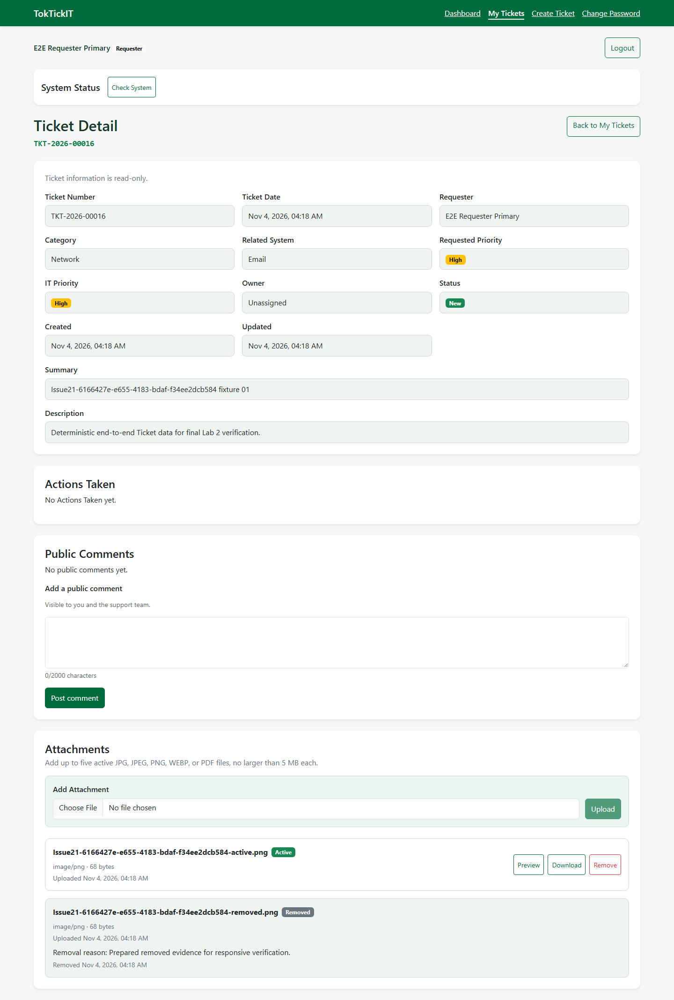

[Open original](fresh/artifacts/lab-02/screenshots/attachment-active-and-removed.png) · SHA256 `81ba40aafdc435832de24a89b443db5b055b1e08358adf059510f2598123e545`

V02 — artifacts/lab-02/screenshots/attachment-removed.png — 1440×2394

**AI observation:** Removal success message, remaining active controls and removed-item cards are readable without overlap.

**Result:** No obvious visual defect in captured pixels. Human inspection/acceptance Pending.

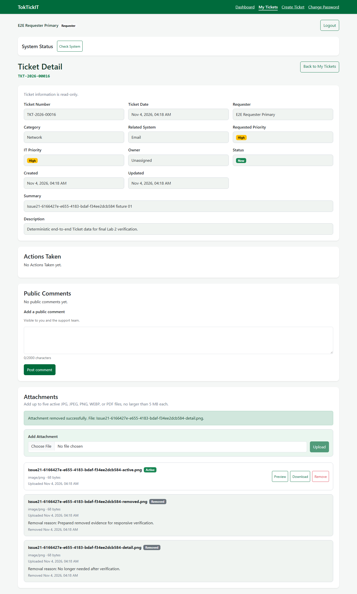

[Open original](fresh/artifacts/lab-02/screenshots/attachment-removed.png) · SHA256 `01bd348f14c98695f797977cbce23a262ba4ced9e102abdfb459f4aa928bd07d`

V03 — artifacts/lab-02/screenshots/create-ticket-desktop.png — 1440×1421

**AI observation:** Complete Create Ticket form shows aligned labels/controls, helper text and both bottom actions; no clipping observed.

**Result:** No obvious visual defect in captured pixels. Human inspection/acceptance Pending.

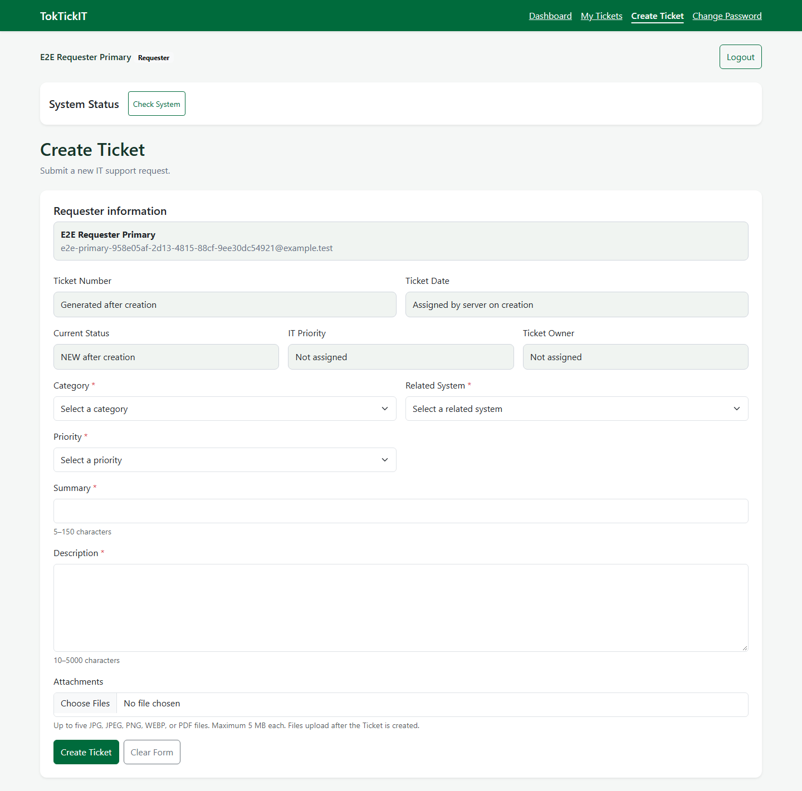

[Open original](fresh/artifacts/lab-02/screenshots/create-ticket-desktop.png) · SHA256 `e376105c727c258b594e157c1c7d33173bfd6df46a2a955983dc9d2a5574c038`

V04 — artifacts/lab-02/screenshots/create-ticket-success.png — 1440×900

**AI observation:** Success panel, Ticket number and next actions are fully visible and readable.

**Result:** No obvious visual defect in captured pixels. Human inspection/acceptance Pending.

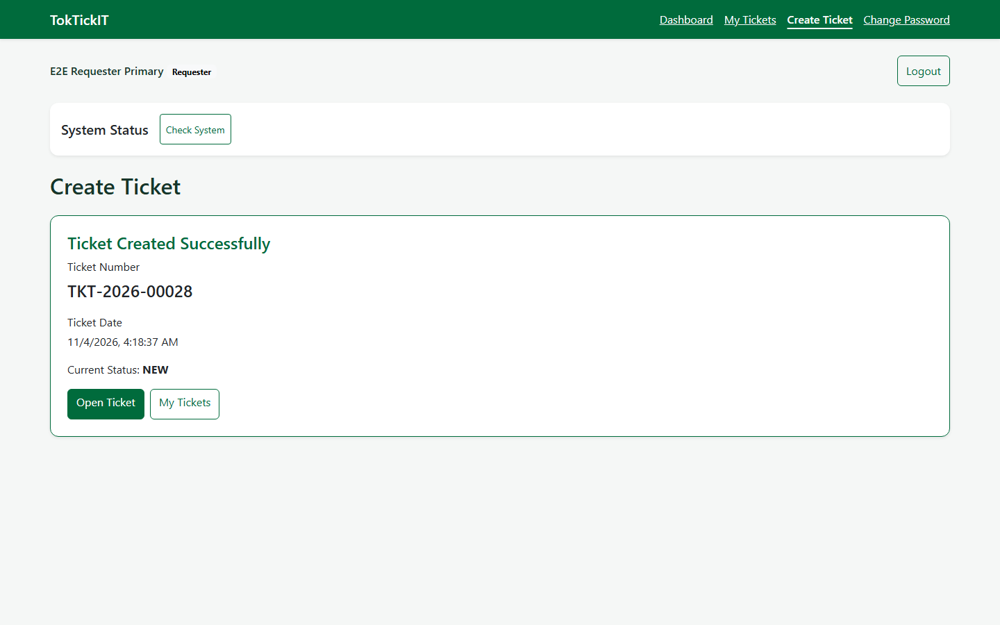

[Open original](fresh/artifacts/lab-02/screenshots/create-ticket-success.png) · SHA256 `5830081ffeb109fb310e7077126b3a7e40fd4c517a20f06e3b1a0cd1809aecab`

V05 — artifacts/lab-02/screenshots/create-ticket-validation.png — 1440×1595

**AI observation:** Validation summary and field-specific red feedback fit without overlapping labels or controls.

**Result:** No obvious visual defect in captured pixels. Human inspection/acceptance Pending.

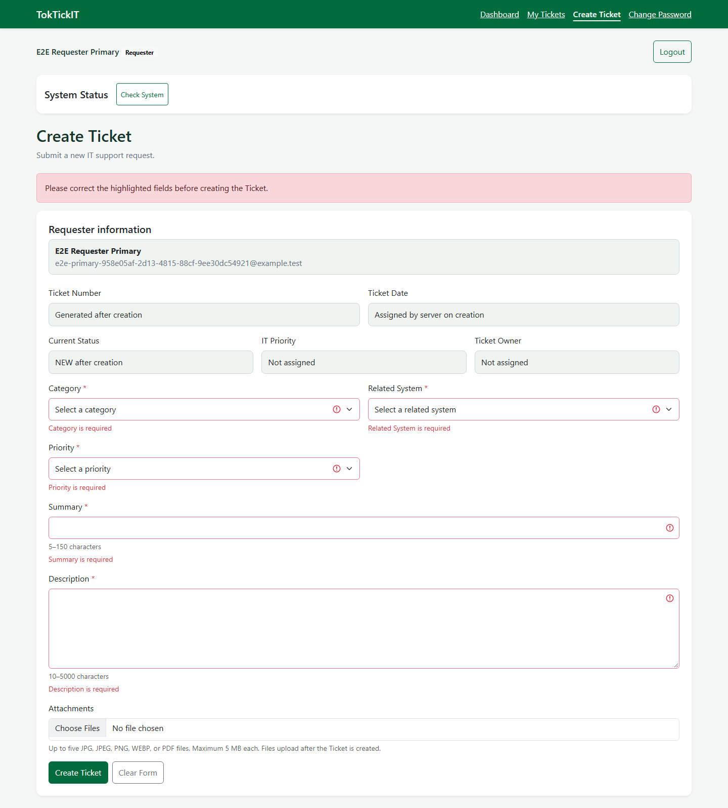

[Open original](fresh/artifacts/lab-02/screenshots/create-ticket-validation.png) · SHA256 `e0e2b48c240ad90c644e98e53edad61e2416a774800ca0a0162a897757c0f84c`

V06 — artifacts/lab-02/screenshots/my-tickets-desktop.png — 1440×1813

**AI observation:** My Tickets filters/table/pagination fit; Ticket number and long summary wrap rather than overlap. Green search focus indicator visible.

**Result:** No obvious visual defect in captured pixels. Human inspection/acceptance Pending.

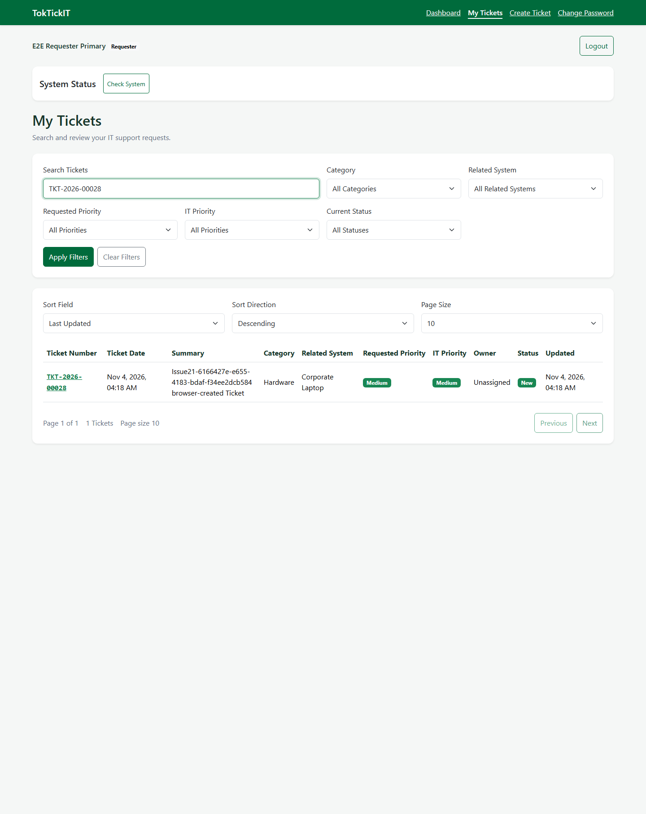

[Open original](fresh/artifacts/lab-02/screenshots/my-tickets-desktop.png) · SHA256 `04473f283459bdba1f4d98dc59c544ccbfd48b1fb1e5aa2bab26842d6f639f0c`

V07 — artifacts/lab-02/screenshots/my-tickets-filtered-desktop.png — 1440×1457

**AI observation:** Filtered multi-row table wraps long summaries and Ticket numbers; pagination remains visible below rows.

**Result:** No obvious visual defect in captured pixels. Human inspection/acceptance Pending.

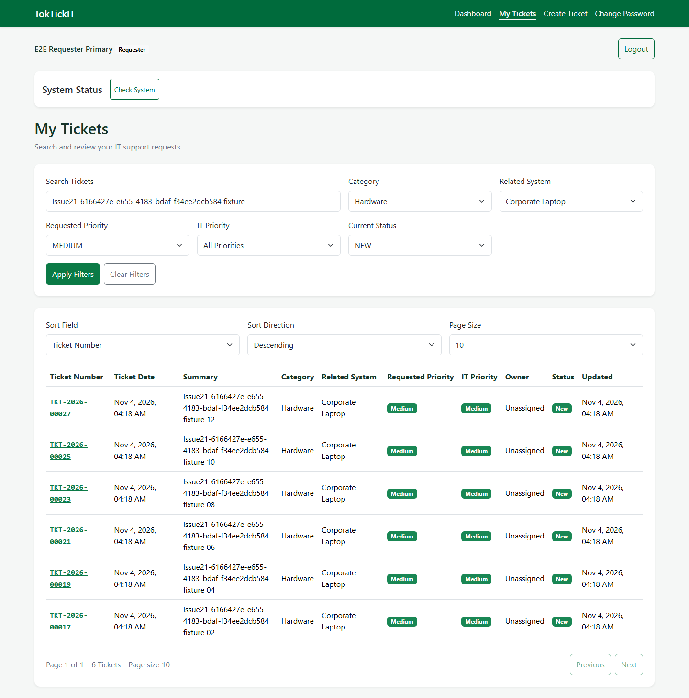

[Open original](fresh/artifacts/lab-02/screenshots/my-tickets-filtered-desktop.png) · SHA256 `af3337d7852bfbf7200c5a58fd1fa1b8fa6707acd3bd944ed7dfd8560cfdab78`

V08 — artifacts/lab-02/screenshots/ownership-safe-not-found.png — 1440×900

**AI observation:** Not-found state and Back action are readable in the card, without protected content disclosure visible.

**Result:** No obvious visual defect in captured pixels. Human inspection/acceptance Pending.

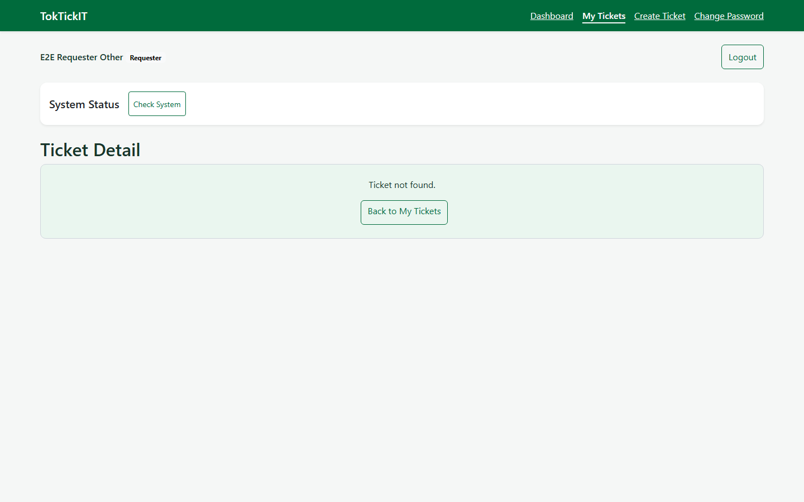

[Open original](fresh/artifacts/lab-02/screenshots/ownership-safe-not-found.png) · SHA256 `92de65ea855242d97eeba86322e534a519372261f9265292de0fbc91fb01285c`

V09 — artifacts/lab-02/screenshots/requester-selection-desktop.png — 1440×900

**AI observation:** Actual screenshot is the Sign in form despite its historical requester-selection filename; email/password labels, checkbox and submit fit the centered card.

**Result:** No obvious visual defect in captured pixels. Human inspection/acceptance Pending.

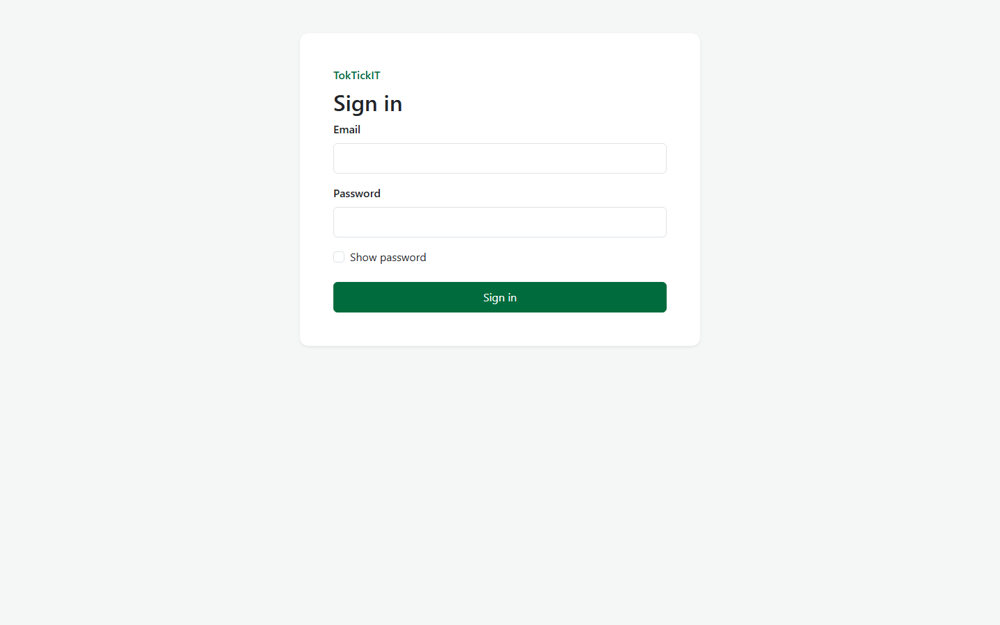

[Open original](fresh/artifacts/lab-02/screenshots/requester-selection-desktop.png) · SHA256 `758b9b245f42ff3b61d5e8c7378e9c127e32d7de4d6cba4612a51176905ab1f2`

V10 — artifacts/lab-02/screenshots/safe-api-error.png — 1440×932

**AI observation:** Safe-error panel, retry action and retained list filters are readable and separated.

**Result:** No obvious visual defect in captured pixels. Human inspection/acceptance Pending.

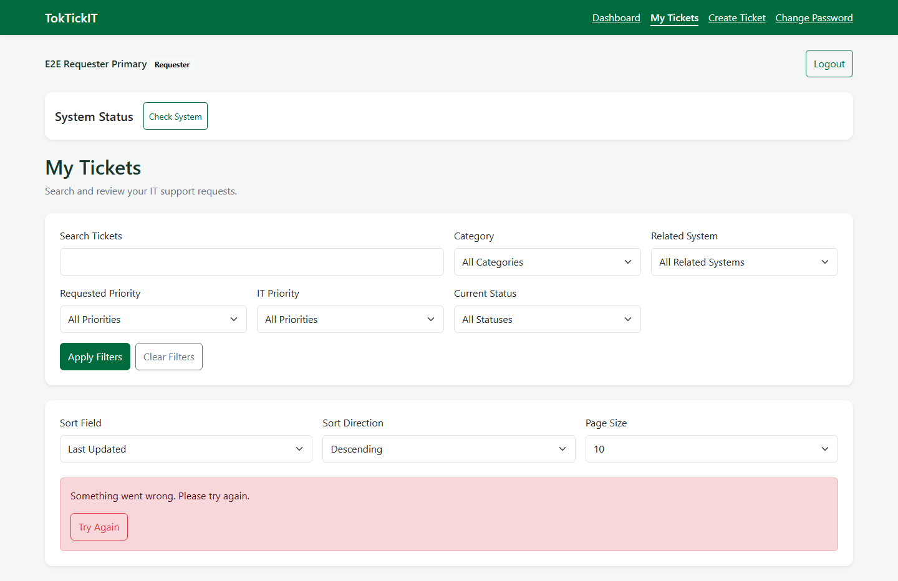

[Open original](fresh/artifacts/lab-02/screenshots/safe-api-error.png) · SHA256 `ed7ac9ed49055f7c876579a693cf0642c22d265fb58d8777ee0eb11f422671b3`

V11 — artifacts/lab-02/screenshots/ticket-detail-desktop.png — 1440×2320

**AI observation:** Full-page Ticket detail and all attachment lifecycle cards remain aligned/readable on desktop.

**Result:** No obvious visual defect in captured pixels. Human inspection/acceptance Pending.

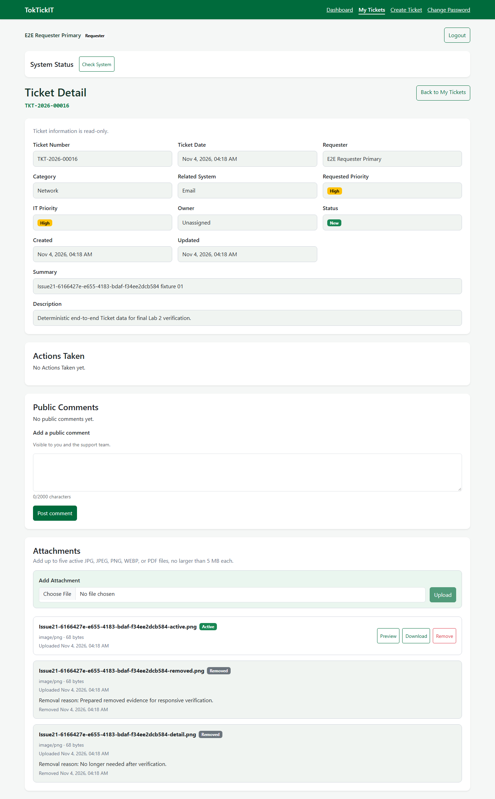

[Open original](fresh/artifacts/lab-02/screenshots/ticket-detail-desktop.png) · SHA256 `8e75421d1be4b495e74b66ee6fb741de8e510dfcae9fcbd805409c1fee7f4a0d`

V12 — artifacts/lab-02/screenshots/ticket-detail-mobile.png — 390×3451

**AI observation:** 390px full-page detail uses a single column; summary/filenames/reasons wrap and attachment actions stack without horizontal clipping.

**Result:** No obvious visual defect in captured pixels. Human inspection/acceptance Pending.

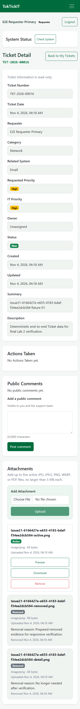

[Open original](fresh/artifacts/lab-02/screenshots/ticket-detail-mobile.png) · SHA256 `a3cc0dac65c096435df647140425d7f273f7183217d80415c64c5f77569d8c45`

V13 — artifacts/lab-02/screenshots/ticket-detail-tablet-boundary.png — 768×2548

**AI observation:** 768px boundary uses two-column details; attachment filename wraps above separate controls without overlap.

**Result:** No obvious visual defect in captured pixels. Human inspection/acceptance Pending.

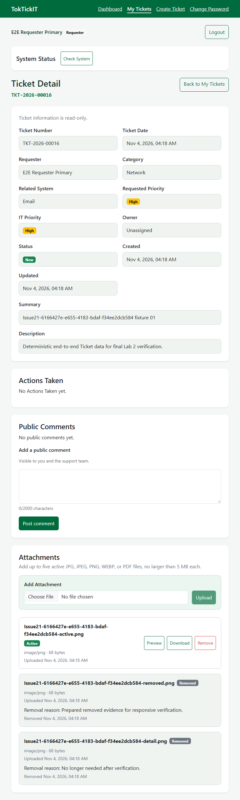

[Open original](fresh/artifacts/lab-02/screenshots/ticket-detail-tablet-boundary.png) · SHA256 `f21ba7379ccf3e084267221caf07d09f324482abcaf23c9bcb9957d7f5986422`

V14 — artifacts/lab-02/screenshots/ticket-detail-tablet-large.png — 1024×2317

**AI observation:** 1024px uses three-column details; attachment rows/actions and content remain contained.

**Result:** No obvious visual defect in captured pixels. Human inspection/acceptance Pending.

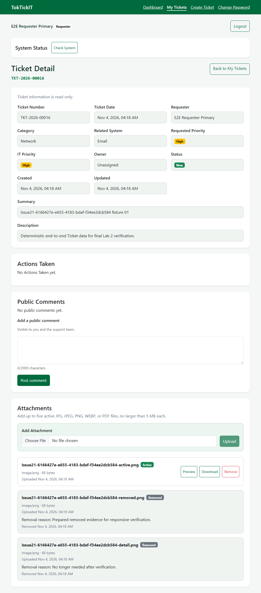

[Open original](fresh/artifacts/lab-02/screenshots/ticket-detail-tablet-large.png) · SHA256 `721df586669486cf33eec64702b40696d233429068bd102bfe4dd00518b8483d`

V15 — artifacts/lab-02/screenshots/ticket-detail-tablet.png — 820×2549

**AI observation:** 820px uses two-column details; long filename wraps and action buttons remain separated/readable.

**Result:** No obvious visual defect in captured pixels. Human inspection/acceptance Pending.

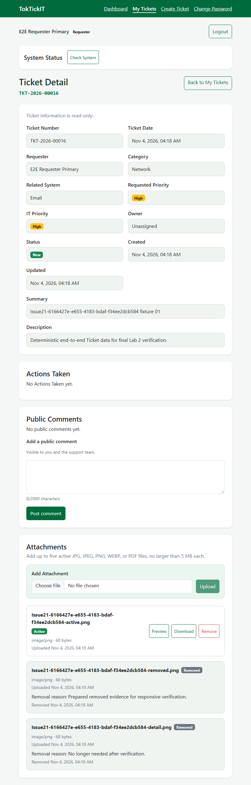

[Open original](fresh/artifacts/lab-02/screenshots/ticket-detail-tablet.png) · SHA256 `62c4051832b7f669a326fa1cb79b947d35ac8ca743a41ac602e74f0797a2948c`

V16 — artifacts/lab-03/screenshots/desktop-1440x900/admin-user-management.png — 1440×900

**AI observation:** Scrolled desktop User Management viewport shows readable search/role controls, complete table columns and Edit buttons; top-edge crop is capture position, not proof of layout clipping.

**Result:** No obvious visual defect in captured pixels. Human inspection/acceptance Pending.

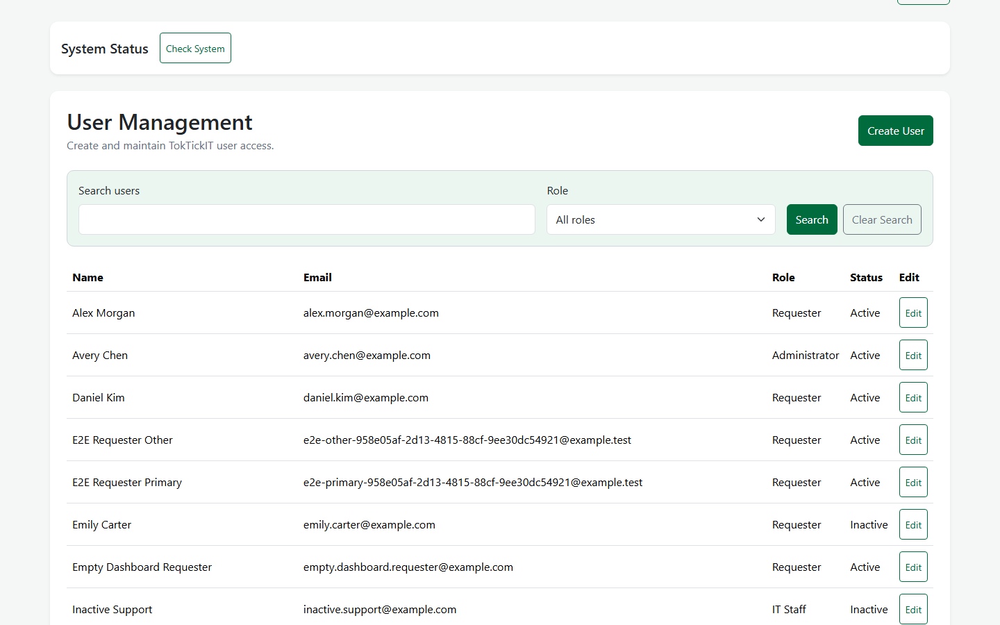

[Open original](fresh/artifacts/lab-03/screenshots/desktop-1440x900/admin-user-management.png) · SHA256 `d1a7a9787bb3905142cdda3477d4450262591479dcebdf2c4f230e3412c5c3a5`

V17 — artifacts/lab-03/screenshots/desktop-1440x900/requester-ticket-detail.png — 1440×900

**AI observation:** Scrolled public-comment and attachment region: labels, textarea, count and desktop upload row fit.

**Result:** No obvious visual defect in captured pixels. Human inspection/acceptance Pending.

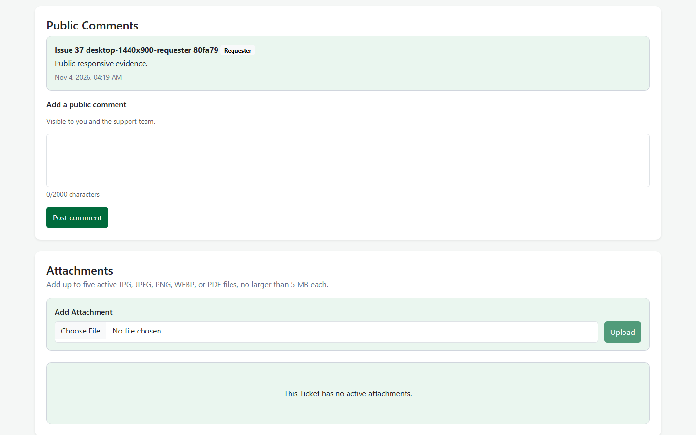

[Open original](fresh/artifacts/lab-03/screenshots/desktop-1440x900/requester-ticket-detail.png) · SHA256 `81a30754e43b6f2c0a548a4816fcac1c5a50f7cd465517612040c48fd506f312`

V18 — artifacts/lab-03/screenshots/desktop-1440x900/staff-ticket-detail.png — 1440×900

**AI observation:** Scrolled staff detail: internal-note distinction, long actor name, note input and status-history panel readable.

**Result:** No obvious visual defect in captured pixels. Human inspection/acceptance Pending.

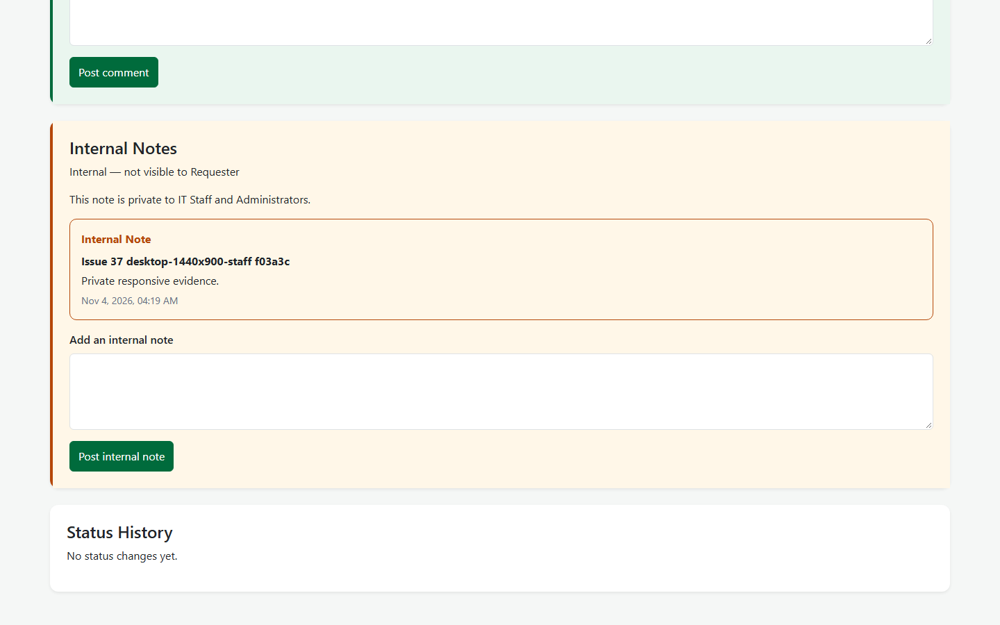

[Open original](fresh/artifacts/lab-03/screenshots/desktop-1440x900/staff-ticket-detail.png) · SHA256 `45ef8e400b93a0356484ffe8c2cdfeecc541d9def3552ae7125c5396e26ed537`

V19 — artifacts/lab-03/screenshots/desktop-1440x900/staff-ticket-queue.png — 1440×900

**AI observation:** Scrolled desktop queue: filters, wrapped row fields, status/priority badges and pagination readable.

**Result:** No obvious visual defect in captured pixels. Human inspection/acceptance Pending.

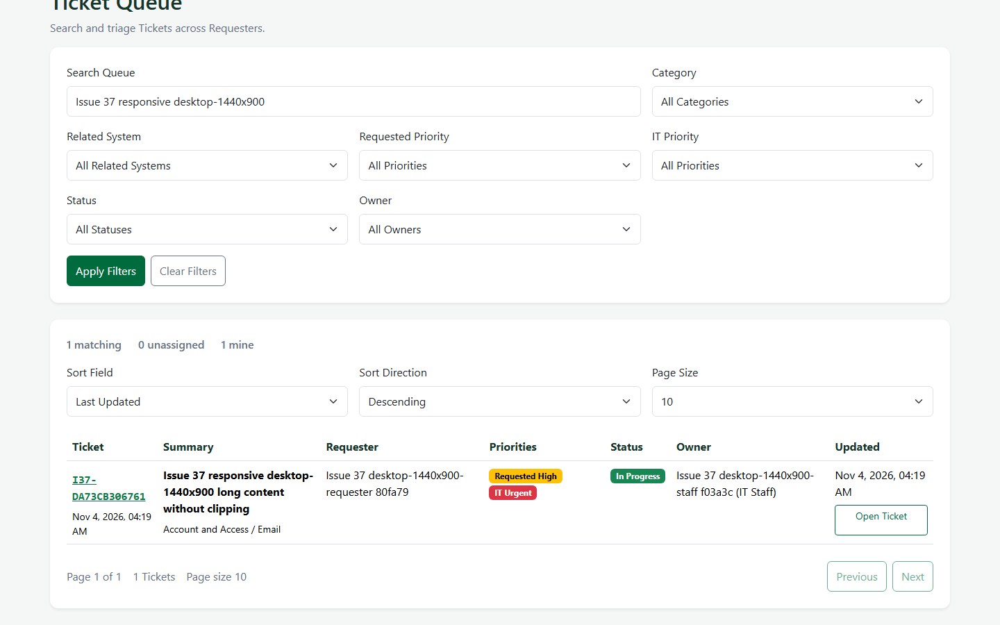

[Open original](fresh/artifacts/lab-03/screenshots/desktop-1440x900/staff-ticket-queue.png) · SHA256 `4081da9bcf84070eb89aee5bdbc7bba6b7c6797a7ef515ea39962f0ce33e4161`

V20 — artifacts/lab-03/screenshots/mobile-390x844/admin-user-management.png — 390×844

**AI observation:** Scrolled mobile admin: user cards stack with visible Email/Role/Status labels and Edit actions.

**Result:** No obvious visual defect in captured pixels. Human inspection/acceptance Pending.

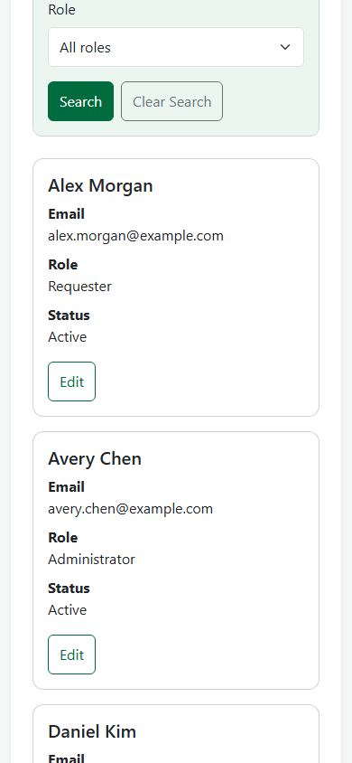

[Open original](fresh/artifacts/lab-03/screenshots/mobile-390x844/admin-user-management.png) · SHA256 `8f90e0c5a7567c9431d47a5868534d3c7114d55adc73b37d854c2588c62bdd66`

V21 — artifacts/lab-03/screenshots/mobile-390x844/requester-ticket-detail.png — 390×844

**AI observation:** Scrolled mobile requester: comment author wraps; textarea and file upload controls stack inside cards.

**Result:** No obvious visual defect in captured pixels. Human inspection/acceptance Pending.

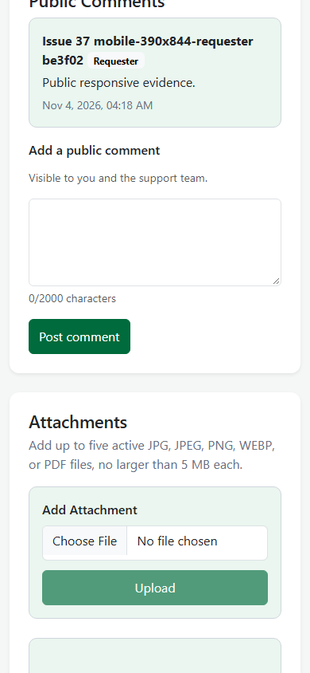

[Open original](fresh/artifacts/lab-03/screenshots/mobile-390x844/requester-ticket-detail.png) · SHA256 `093683640b2366d50e58cd5d9c884654fb33ba9b1a9f97fbd412ded12ad53e3c`

V22 — artifacts/lab-03/screenshots/mobile-390x844/staff-ticket-detail.png — 390×844

**AI observation:** Scrolled mobile staff: private-note label, multilingual actor text, input and history panel fit.

**Result:** No obvious visual defect in captured pixels. Human inspection/acceptance Pending.

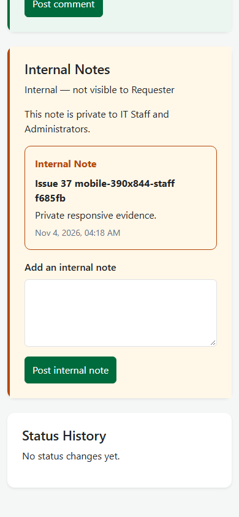

[Open original](fresh/artifacts/lab-03/screenshots/mobile-390x844/staff-ticket-detail.png) · SHA256 `0c4f2563b5a523909538c398cdb8ee943d2b52e0f87094e23473267bcd7af399`

V23 — artifacts/lab-03/screenshots/mobile-390x844/staff-ticket-queue.png — 390×844

**AI observation:** Mobile queue record uses stacked labeled fields; long identity/summary wrap and pagination buttons fit.

**Result:** No obvious visual defect in captured pixels. Human inspection/acceptance Pending.

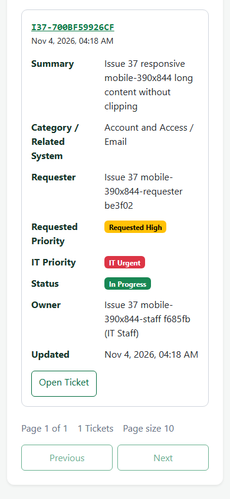

[Open original](fresh/artifacts/lab-03/screenshots/mobile-390x844/staff-ticket-queue.png) · SHA256 `30c96facca72a46392f2be00fd015ad9d59a342520f7672c6db6baf8aba027bf`

V24 — artifacts/lab-03/screenshots/tablet-834x1112/admin-user-management.png — 834×1112

**AI observation:** Tablet admin table fits its container; long emails wrap over multiple lines without covering adjacent columns.

**Result:** No obvious visual defect in captured pixels. Human inspection/acceptance Pending.

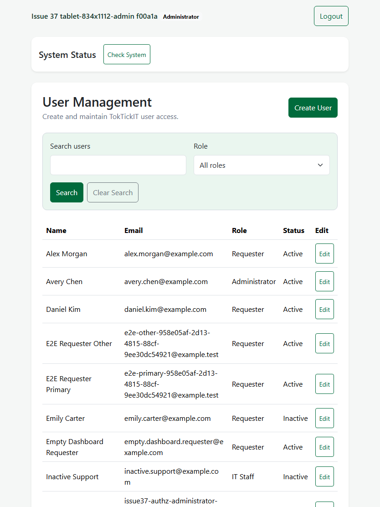

[Open original](fresh/artifacts/lab-03/screenshots/tablet-834x1112/admin-user-management.png) · SHA256 `921a4d76784508f56a770185d32604ab08b0e9262d43d4d8b57cea76a5808fd5`

V25 — artifacts/lab-03/screenshots/tablet-834x1112/requester-ticket-detail.png — 834×1112

**AI observation:** Scrolled tablet requester detail: empty Actions, public comment and upload regions fit.

**Result:** No obvious visual defect in captured pixels. Human inspection/acceptance Pending.

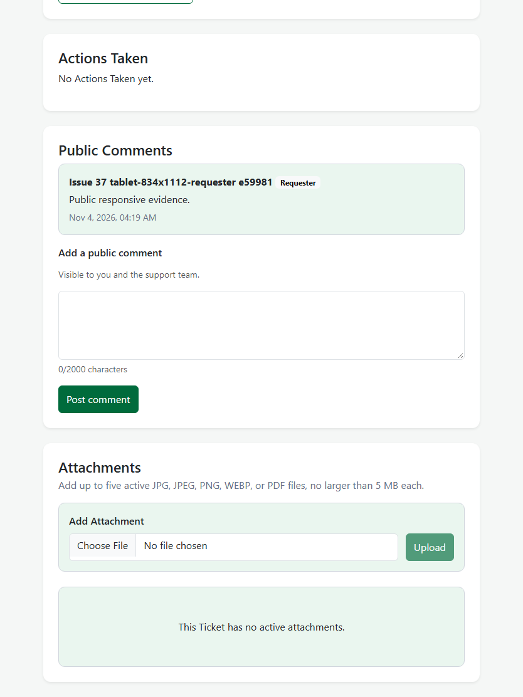

[Open original](fresh/artifacts/lab-03/screenshots/tablet-834x1112/requester-ticket-detail.png) · SHA256 `2bbcf89a175ce210e6034d7e2412f9434a52b4c275e03b26aa731f6117613fb7`

V26 — artifacts/lab-03/screenshots/tablet-834x1112/staff-ticket-detail.png — 834×1112

**AI observation:** Scrolled tablet staff detail: public/internal note separation, textareas and status history readable.

**Result:** No obvious visual defect in captured pixels. Human inspection/acceptance Pending.

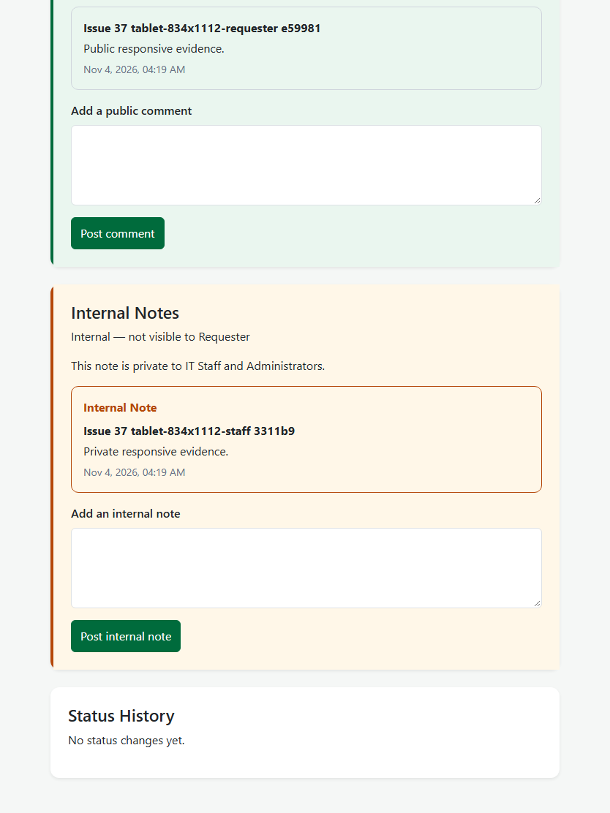

[Open original](fresh/artifacts/lab-03/screenshots/tablet-834x1112/staff-ticket-detail.png) · SHA256 `2eb4615161ed44e009e1a561f79b50fd930a35dad22b66390b0e22e0dc8cdb36`

V27 — artifacts/lab-03/screenshots/tablet-834x1112/staff-ticket-queue.png — 834×1112

**AI observation:** Tablet queue: visible right-hand table columns and pagination fit; left columns are outside the captured table window. Verify horizontal scroll intent/reachability from source; screenshot alone cannot establish full row access.

**Result:** Captured region readable; coverage qualification recorded. Human inspection/acceptance Pending.

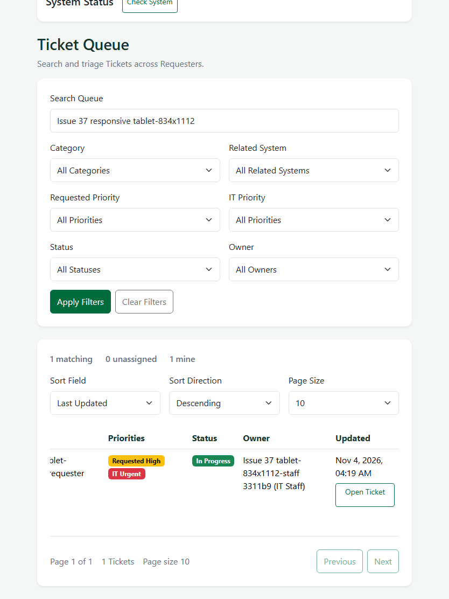

[Open original](fresh/artifacts/lab-03/screenshots/tablet-834x1112/staff-ticket-queue.png) · SHA256 `f38416fe9053b5d3ffebac8773aafefe0761b90ce9db22566e2cf8220ed43458`

V28 — artifacts/lab-04/screenshots/actions-taken/1440x900-cancel.png — 1440×900

**AI observation:** Cancel dialog fits desktop viewport with visible title, focused multiline reason, helper and both buttons; textarea content is internally scrolled.

**Result:** No obvious visual defect in captured pixels. Human inspection/acceptance Pending.

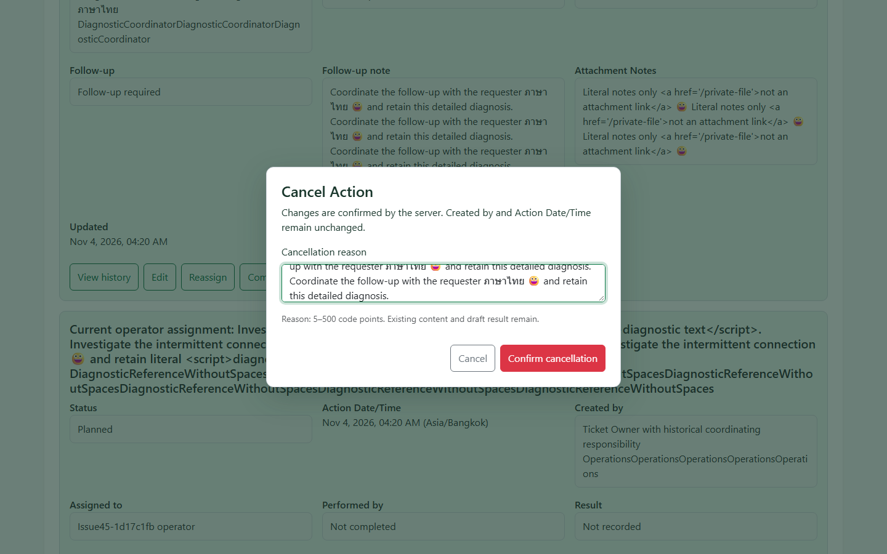

[Open original](fresh/artifacts/lab-04/screenshots/actions-taken/1440x900-cancel.png) · SHA256 `f9ef8475016e08e9e373381f7c42845df372e37298512dcbee9d5324abbcdd8c`

V29 — artifacts/lab-04/screenshots/actions-taken/1440x900-complete.png — 1440×900

**AI observation:** Complete dialog title, focused result, helper and both buttons fit; textarea is internally scrolled.

**Result:** No obvious visual defect in captured pixels. Human inspection/acceptance Pending.

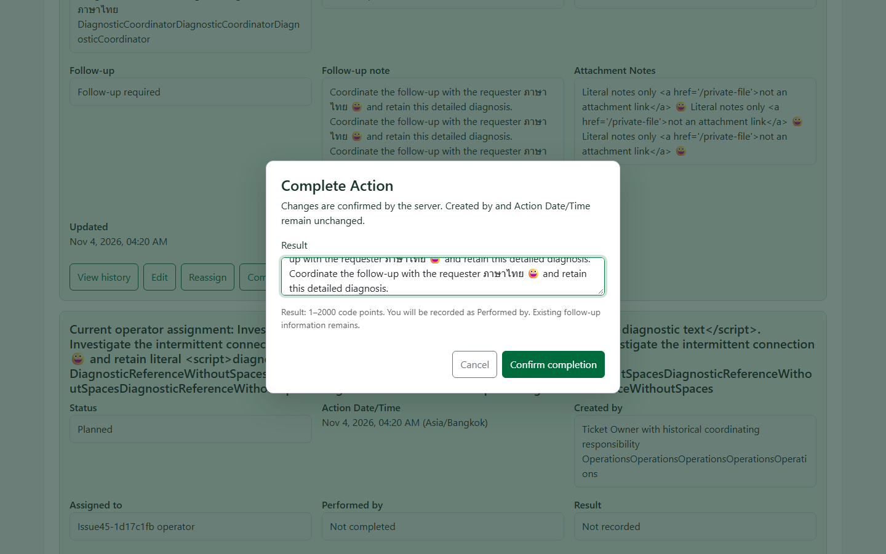

[Open original](fresh/artifacts/lab-04/screenshots/actions-taken/1440x900-complete.png) · SHA256 `ee25282e517302f0f73d3a27f91065310962714221f04e9c52a9f3e53de20d44`

V30 — artifacts/lab-04/screenshots/actions-taken/1440x900-edit.png — 1440×900

**AI observation:** Edit dialog fits viewport; four text fields, checkbox, helper and both actions readable; textareas use internal scrolling.

**Result:** No obvious visual defect in captured pixels. Human inspection/acceptance Pending.

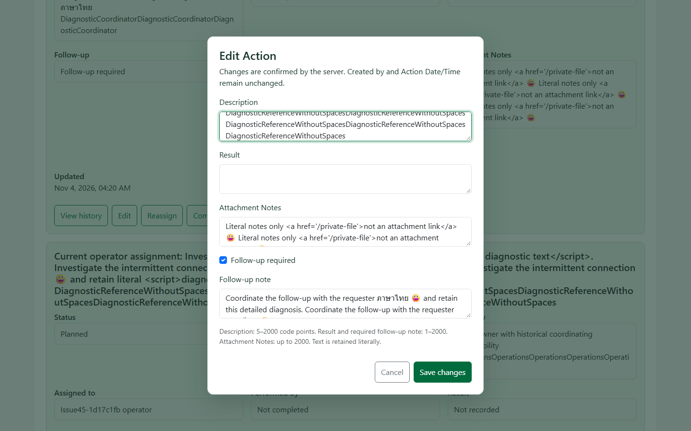

[Open original](fresh/artifacts/lab-04/screenshots/actions-taken/1440x900-edit.png) · SHA256 `25366b05a721654accc2bf13ec5274bd9c7e1f1db6fe0c9f551ea4ee3f1e3398`

V31 — artifacts/lab-04/screenshots/actions-taken/1440x900-history.png — 1440×900

**AI observation:** History dialog wraps actor/time/IDs in columns; content continues below modal viewport. Screenshot cannot establish access to bottom/Close.

**Result:** Captured region readable; coverage qualification recorded. Human inspection/acceptance Pending.

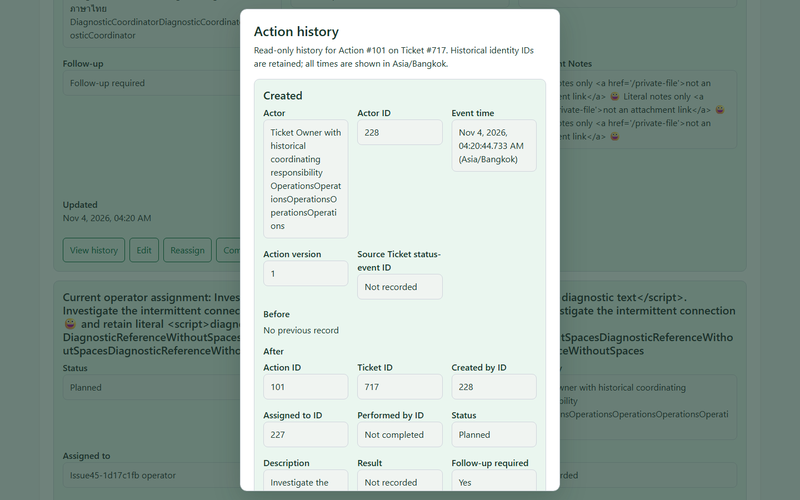

[Open original](fresh/artifacts/lab-04/screenshots/actions-taken/1440x900-history.png) · SHA256 `e6fd9b6c36438c976a9b04f5b6f41f1351a5fd783ef7ce214b55a19873b03423`

V32 — artifacts/lab-04/screenshots/actions-taken/1440x900-my-actions.png — 1440×900

**AI observation:** My assigned Actions desktop navigation/filter grid fit; results continue below capture.

**Result:** No obvious visual defect in captured pixels. Human inspection/acceptance Pending.

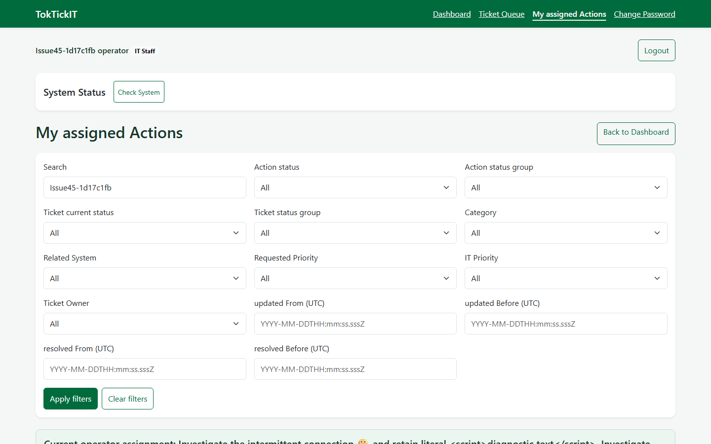

[Open original](fresh/artifacts/lab-04/screenshots/actions-taken/1440x900-my-actions.png) · SHA256 `b20d9592af8a1ec35cf1380d7d358aa3f93702768a4e81542768b2acee7b32b7`

V33 — artifacts/lab-04/screenshots/actions-taken/1440x900-reassign.png — 1440×900

**AI observation:** Reassign dialog select has visible focus; eligibility helper and both actions fit.

**Result:** No obvious visual defect in captured pixels. Human inspection/acceptance Pending.

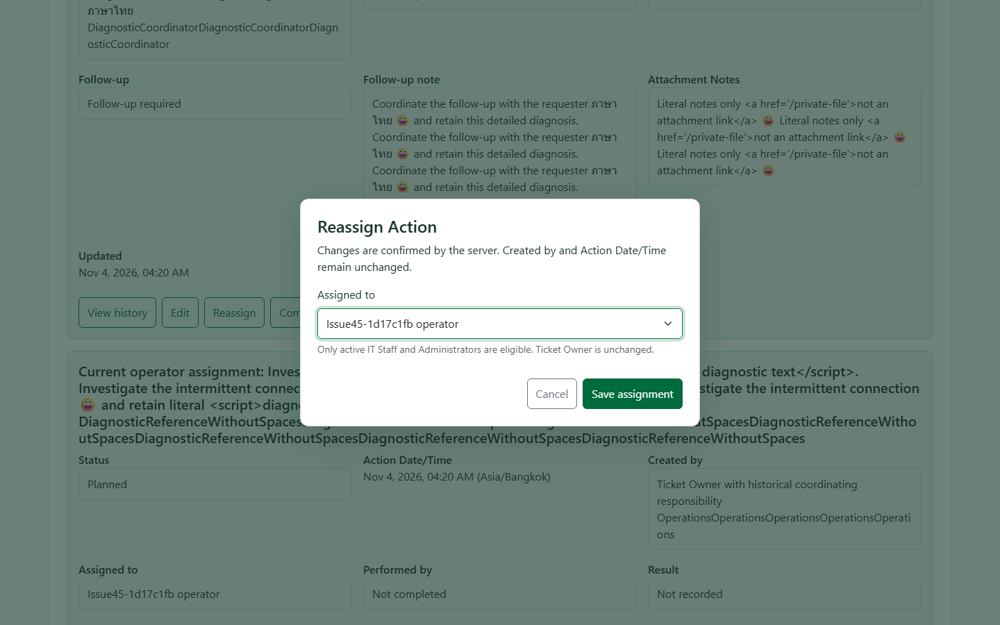

[Open original](fresh/artifacts/lab-04/screenshots/actions-taken/1440x900-reassign.png) · SHA256 `7982aa04d3dcf20043cd2ec9f0124c63e9d2f1bbe24211ddcc511b350f0f9997`

V34 — artifacts/lab-04/screenshots/actions-taken/1440x900-requester-actions.png — 1440×900

**AI observation:** Requester Actions cards wrap long unbroken/multilingual description and identity text; read-only history action visible.

**Result:** No obvious visual defect in captured pixels. Human inspection/acceptance Pending.

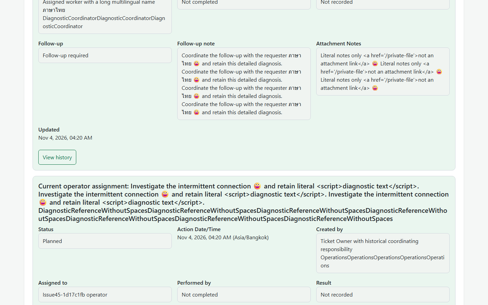

[Open original](fresh/artifacts/lab-04/screenshots/actions-taken/1440x900-requester-actions.png) · SHA256 `18d14d33d657bff9139aee387c1d3bc94c1344a3d2cab6b79ce7cf1b5c49c62f`

V35 — artifacts/lab-04/screenshots/actions-taken/1440x900-staff-actions.png — 1440×900

**AI observation:** Staff Actions cards wrap long text and show separately spaced history/Edit/Reassign/Complete/Cancel controls.

**Result:** No obvious visual defect in captured pixels. Human inspection/acceptance Pending.

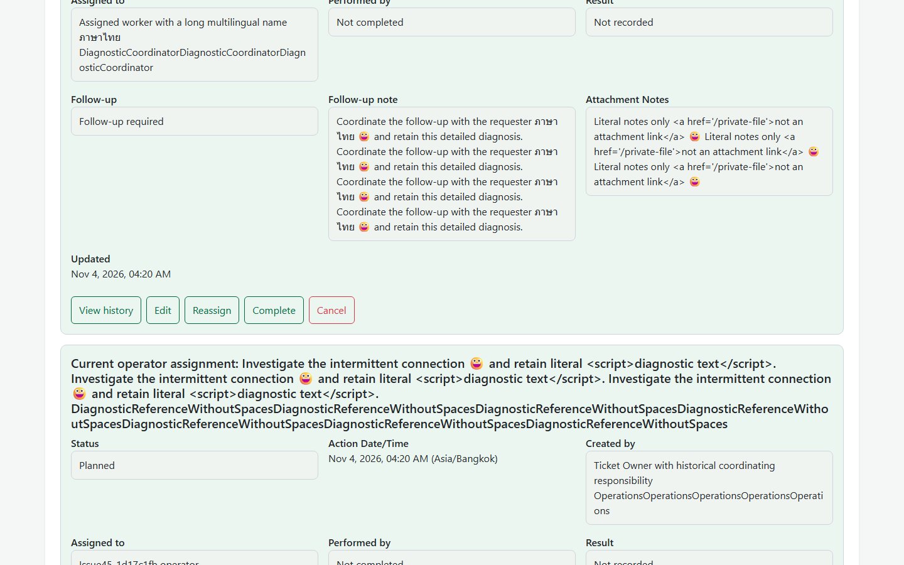

[Open original](fresh/artifacts/lab-04/screenshots/actions-taken/1440x900-staff-actions.png) · SHA256 `6c7a23e0a6c51bbb08d62661a9e25866ed25800418631ee984cb43eec83baec2`

V36 — artifacts/lab-04/screenshots/actions-taken/390x844-history.png — 390×844

**AI observation:** Mobile history dialog reflows to one column; actor, time and IDs fit. Lower history/Close outside capture requires scrolling evidence.

**Result:** Captured region readable; coverage qualification recorded. Human inspection/acceptance Pending.

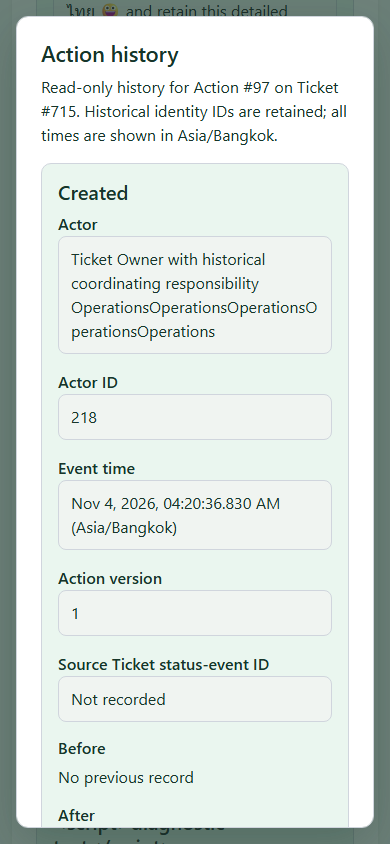

[Open original](fresh/artifacts/lab-04/screenshots/actions-taken/390x844-history.png) · SHA256 `5cd5208d6693bc1992d4ea9875b097c8bbd93af24fa4b77a94eb1d7b60bb2adb`

V37 — artifacts/lab-04/screenshots/actions-taken/390x844-my-actions.png — 390×844

**AI observation:** Mobile My assigned Actions header/Back button and single-column filters fit; lower filters/results below viewport.

**Result:** Captured region readable; coverage qualification recorded. Human inspection/acceptance Pending.

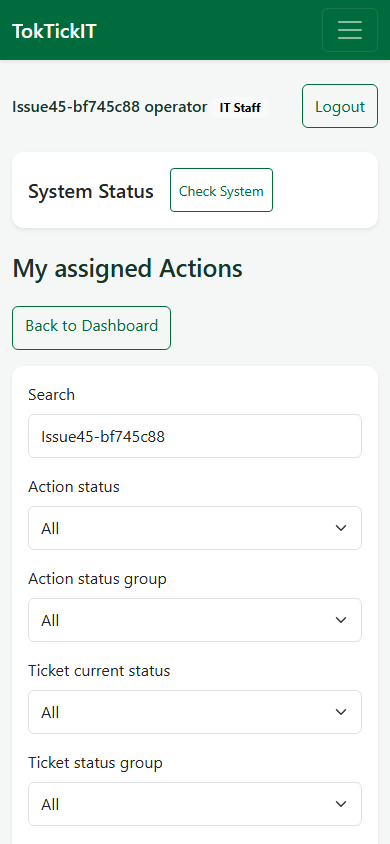

[Open original](fresh/artifacts/lab-04/screenshots/actions-taken/390x844-my-actions.png) · SHA256 `4fdc6d9ecb3e65d6d5139fd13869dc148cd91593011516b8d51089cd584b88e2`

V38 — artifacts/lab-04/screenshots/actions-taken/390x844-requester-actions.png — 390×844

**AI observation:** Mobile requester card wraps literal markup, Thai/emoji and long notes; history button separated from next card.

**Result:** No obvious visual defect in captured pixels. Human inspection/acceptance Pending.

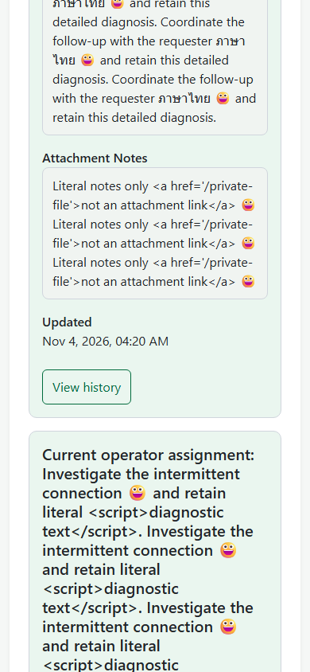

[Open original](fresh/artifacts/lab-04/screenshots/actions-taken/390x844-requester-actions.png) · SHA256 `66ae95e757f58aba2e2c23a6a9659e9567439deee23448b7697b83073d6fcb80`

V39 — artifacts/lab-04/screenshots/actions-taken/390x844-staff-actions.png — 390×844

**AI observation:** Mobile staff card wraps notes; action buttons wrap into two rows without overlap.

**Result:** No obvious visual defect in captured pixels. Human inspection/acceptance Pending.

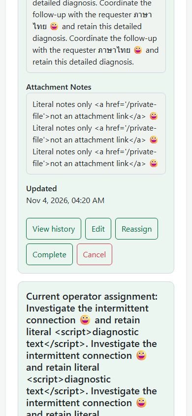

[Open original](fresh/artifacts/lab-04/screenshots/actions-taken/390x844-staff-actions.png) · SHA256 `8c6f8dbf36e6d2c993a09b43bc32ae5a14bf94a0726775be1c60996583e80301`

V40 — artifacts/lab-04/screenshots/actions-taken/834x1112-history.png — 834×1112

**AI observation:** Tablet history uses two columns with readable long actor/time/IDs; bottom remains outside captured modal viewport.

**Result:** Captured region readable; coverage qualification recorded. Human inspection/acceptance Pending.

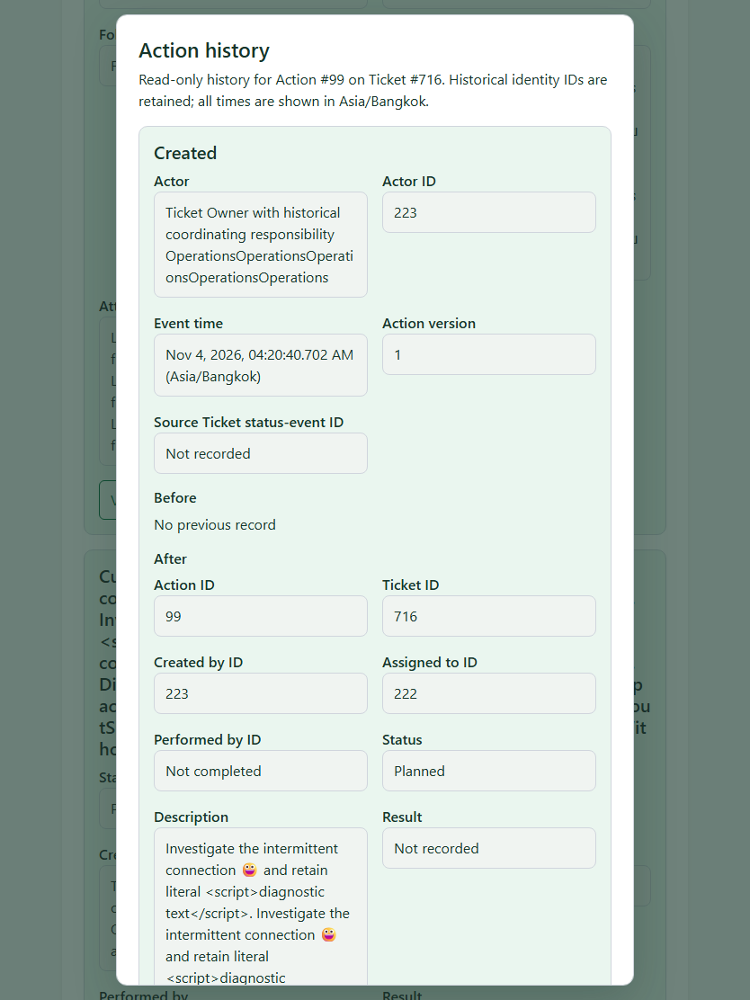

[Open original](fresh/artifacts/lab-04/screenshots/actions-taken/834x1112-history.png) · SHA256 `ab122ab8f86941d634e4a5843295431b000a78e4d7360550ab844b3d5495f87d`

V41 — artifacts/lab-04/screenshots/actions-taken/834x1112-my-actions.png — 834×1112

**AI observation:** Tablet My Actions two-column filter grid, header/navigation and buttons fit.

**Result:** No obvious visual defect in captured pixels. Human inspection/acceptance Pending.

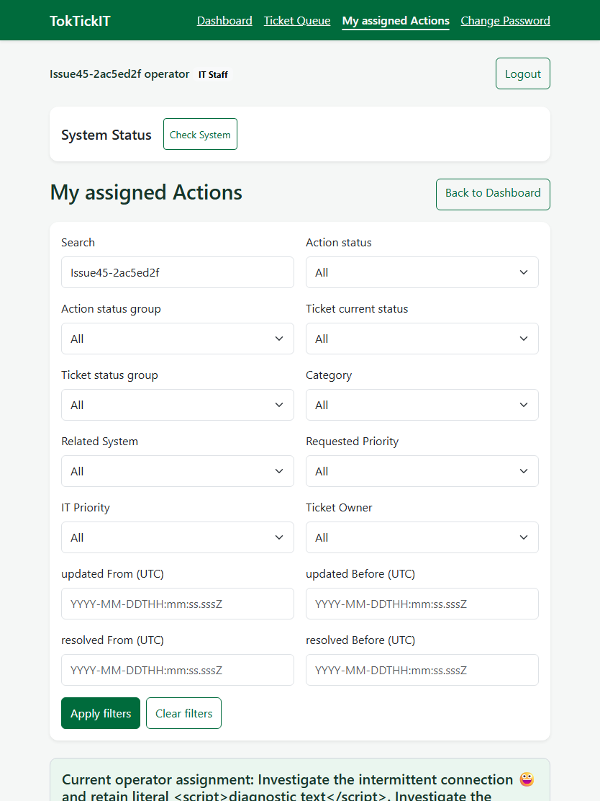

[Open original](fresh/artifacts/lab-04/screenshots/actions-taken/834x1112-my-actions.png) · SHA256 `862e06bb0ce09cab76e2580a18963ecf2f6d3adb266378bc8240ebd999522420`

V42 — artifacts/lab-04/screenshots/actions-taken/834x1112-requester-actions.png — 834×1112

**AI observation:** Tablet requester card uses two columns and wraps long description/notes within the card.

**Result:** No obvious visual defect in captured pixels. Human inspection/acceptance Pending.

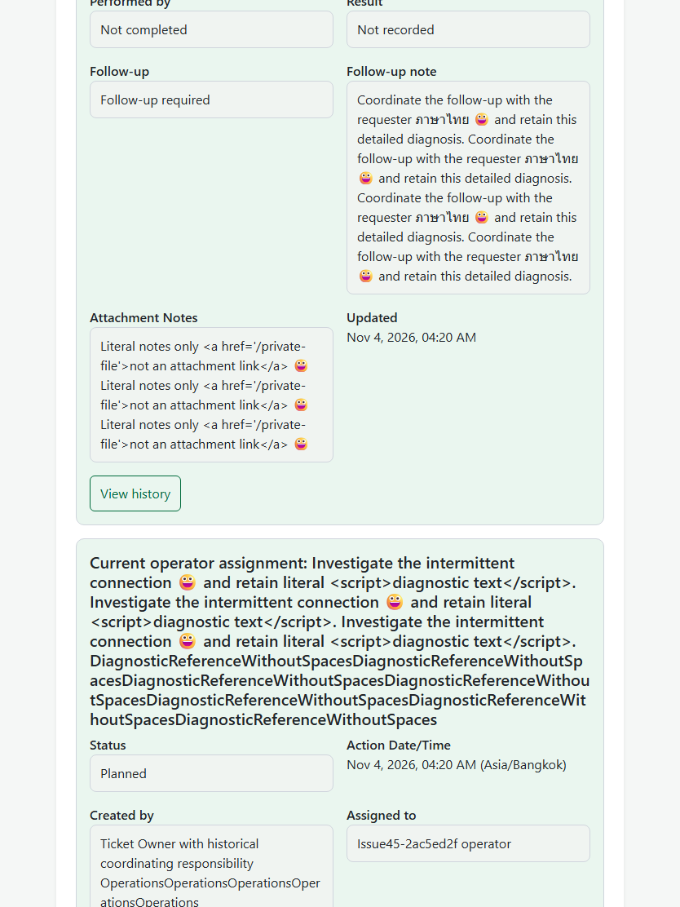

[Open original](fresh/artifacts/lab-04/screenshots/actions-taken/834x1112-requester-actions.png) · SHA256 `16f78f66975b64dc2ff14f1f9c264d2072f1c90724e4f76659fe76bd92a03a2c`

V43 — artifacts/lab-04/screenshots/actions-taken/834x1112-staff-actions.png — 834×1112

**AI observation:** Tablet staff card fits its five visible buttons in one row and wraps long description.

**Result:** No obvious visual defect in captured pixels. Human inspection/acceptance Pending.

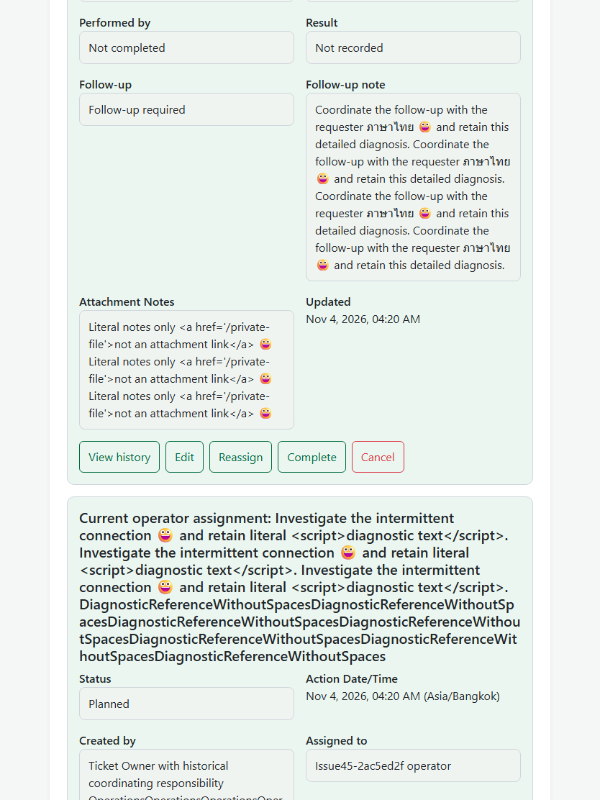

[Open original](fresh/artifacts/lab-04/screenshots/actions-taken/834x1112-staff-actions.png) · SHA256 `5597d94ce984ee37b9c790b53d467ad7f73f3635ab3109417be310aaf8511b2e`

V44 — artifacts/lab-04/screenshots/actions-taken/accessibility-create-errors.png — 1440×900

**AI observation:** Create validation dialog shows red summary, field errors and visible focus; dialog is internally scrolled, title/submit outside captured position.

**Result:** Captured region readable; coverage qualification recorded. Human inspection/acceptance Pending.

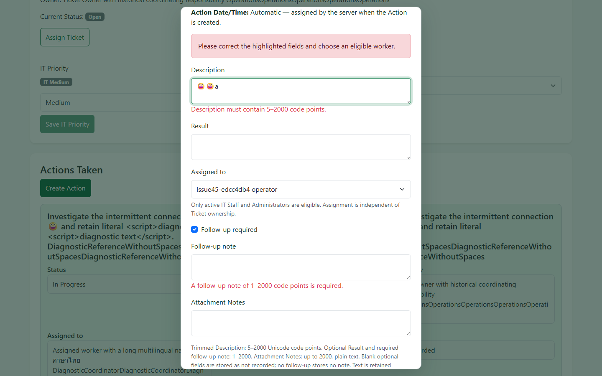

[Open original](fresh/artifacts/lab-04/screenshots/actions-taken/accessibility-create-errors.png) · SHA256 `a10d10735c2767dce1c1751501e5da59bdfe2d6cab0dcaae28be5cc0e460ec66`

V45 — artifacts/lab-04/screenshots/actions-taken/accessibility-history-error.png — 1440×900

**AI observation:** History failure dialog shows safe alert, clearly visible Retry focus ring, pagination and Close.

**Result:** No obvious visual defect in captured pixels. Human inspection/acceptance Pending.

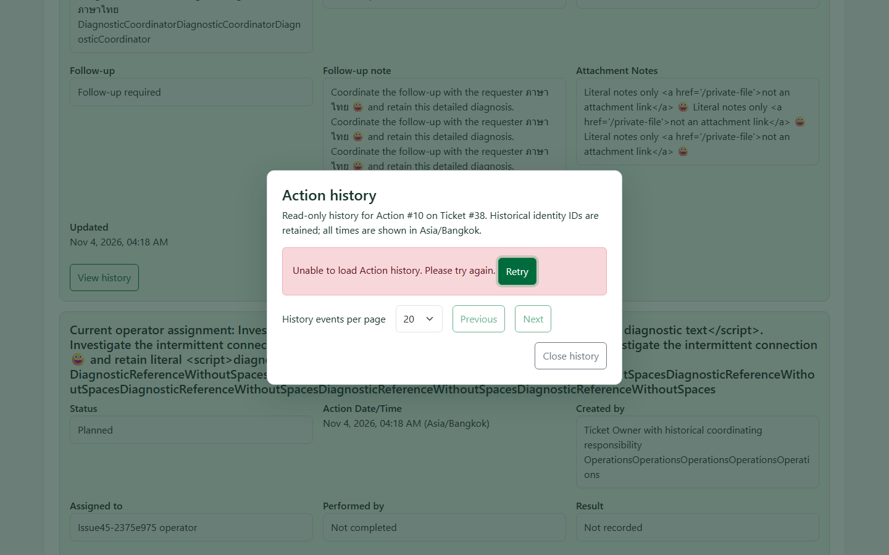

[Open original](fresh/artifacts/lab-04/screenshots/actions-taken/accessibility-history-error.png) · SHA256 `6be4d8ea03edbc9799d6c0fe23788462085a52ba06a3125f79c4f75502f2a448`

V46 — artifacts/lab-04/screenshots/actions-taken/accessibility-my-actions-focus.png — 1440×900

**AI observation:** Desktop Apply filters has visible focus ring; filter grid/navigation labels readable.

**Result:** No obvious visual defect in captured pixels. Human inspection/acceptance Pending.

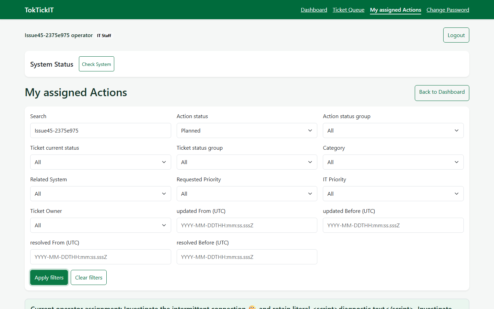

[Open original](fresh/artifacts/lab-04/screenshots/actions-taken/accessibility-my-actions-focus.png) · SHA256 `02969ff7332521e62eec8853203e879a8fb4d221c0e96f7f73e1da149d16581e`

V47 — artifacts/lab-04/screenshots/actions-taken/zoom200-create.png — 1424×805

**AI observation:** 200% Create dialog heading/instructions/description fit width; modal continues vertically below capture.

**Result:** Captured region readable; coverage qualification recorded. Human inspection/acceptance Pending.

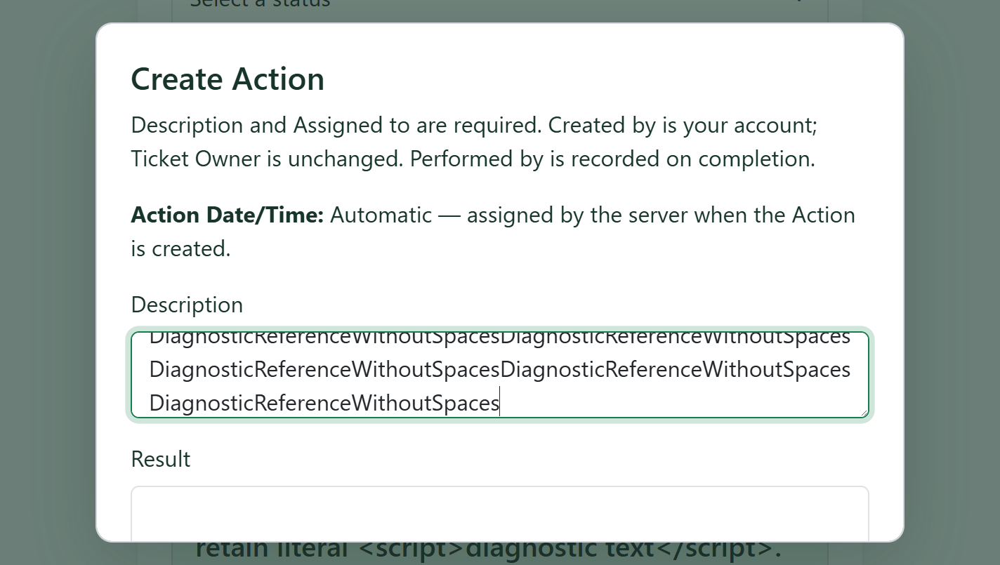

[Open original](fresh/artifacts/lab-04/screenshots/actions-taken/zoom200-create.png) · SHA256 `752425cb78fed2fb40946b432a6ed2e16a2554a2c011302a33032eb3460d65a6`

V48 — artifacts/lab-04/screenshots/actions-taken/zoom200-history.png — 1424×805

**AI observation:** 200% History bottom shows page-size focus, stacked Previous/Next and Close fully visible. Minor spacing issue: event count and History events per page label visually concatenate (eventsHistory); no overlap/blockage demonstrated.

**Result:** Minor spacing observation; no blocking defect established. Human inspection/acceptance Pending.

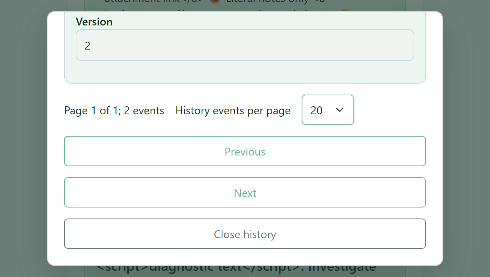

[Open original](fresh/artifacts/lab-04/screenshots/actions-taken/zoom200-history.png) · SHA256 `65ec52d50cf9d7c13321d3fb1f5755f01048af9007b3cef98166ca66847e4fb0`

V49 — artifacts/lab-04/screenshots/actions-taken/zoom200-my-actions.png — 1424×805

**AI observation:** 200% My Actions header switches to collapsed navigation; title/Back button fit; filters continue below.

**Result:** Captured region readable; coverage qualification recorded. Human inspection/acceptance Pending.

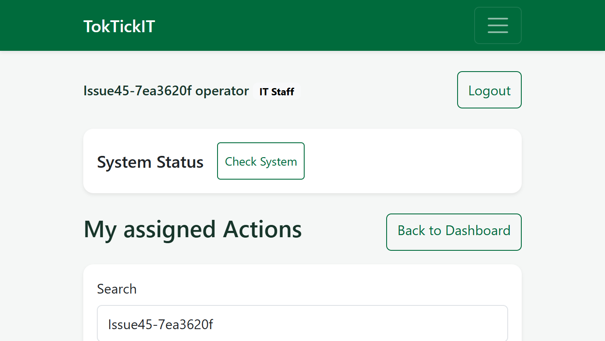

[Open original](fresh/artifacts/lab-04/screenshots/actions-taken/zoom200-my-actions.png) · SHA256 `a2b2ad5eed94697b213bfce156c95791ad79ac054a5a2a9b4ad28a53335dbf32`

V50 — artifacts/lab-04/screenshots/actions-taken/zoom200-staff-actions.png — 1424×805

**AI observation:** 200% staff card wraps action controls with Cancel on a second row; text remains within card.

**Result:** No obvious visual defect in captured pixels. Human inspection/acceptance Pending.

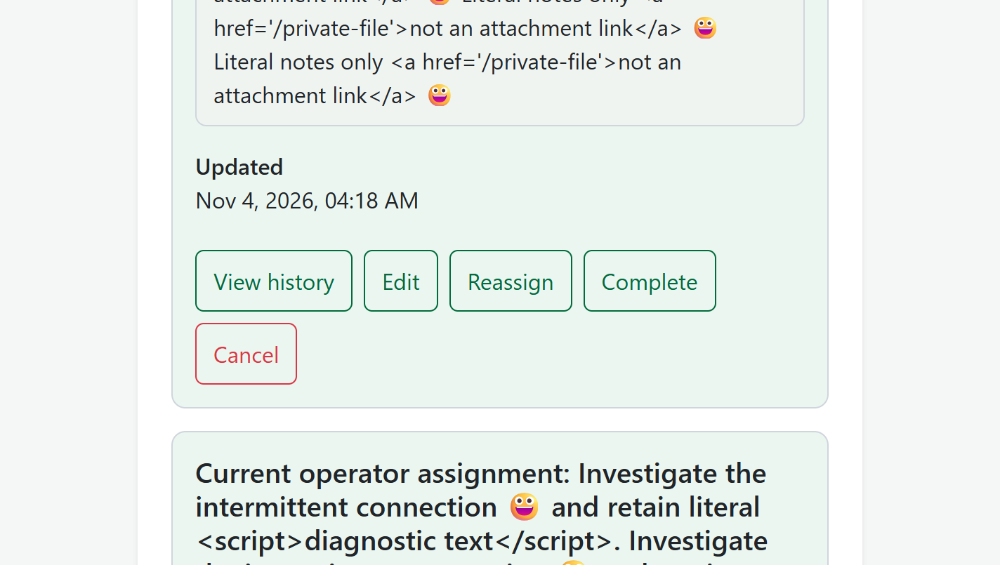

[Open original](fresh/artifacts/lab-04/screenshots/actions-taken/zoom200-staff-actions.png) · SHA256 `ea81f42301ca5bbe98667da8227dd9737b7c69c2bab82c4bd32b7cf47083159e`

V51 — artifacts/lab-04/screenshots/dashboard-navigation/admin-zoom-200.png — 1424×805

**AI observation:** 200% admin expanded menu wraps multiword links, visible menu focus, identity and Dashboard heading fit.

**Result:** No obvious visual defect in captured pixels. Human inspection/acceptance Pending.

[Open original](fresh/artifacts/lab-04/screenshots/dashboard-navigation/admin-zoom-200.png) · SHA256 `b3d34e445dc8b75dbf0f056c98ecff672ee0cac8153369fa6a05be2ac589e000`

V52 — artifacts/lab-04/screenshots/dashboard-navigation/requester-desktop.png — 1440×900

**AI observation:** Requester desktop navigation/filter grid/as-of/metric cards fit in viewport; recent list starts below.

**Result:** No obvious visual defect in captured pixels. Human inspection/acceptance Pending.

[Open original](fresh/artifacts/lab-04/screenshots/dashboard-navigation/requester-desktop.png) · SHA256 `f0512d1d2d3ffb04d0f1ef2955af5e6f84e5fffcd2d34ec0301624d59d2d7a11`

V53 — artifacts/lab-04/screenshots/dashboard-navigation/staff-mobile-menu.png — 390×844

**AI observation:** Mobile staff expanded menu links wrap visibly; focus ring visible and single-column Dashboard filters fit.

**Result:** No obvious visual defect in captured pixels. Human inspection/acceptance Pending.

[Open original](fresh/artifacts/lab-04/screenshots/dashboard-navigation/staff-mobile-menu.png) · SHA256 `c833f4502a17de477a6e221b10af633748692dad5835ddfe69e5534bccef7f0f`

V54 — artifacts/lab-04/screenshots/requester-dashboard/initial/1440x900-filters.png — 1296×261

**AI observation:** Desktop filter component crop: six labeled controls and Apply/Clear fit; outside component not observed.

**Result:** Captured region readable; coverage qualification recorded. Human inspection/acceptance Pending.

[Open original](fresh/artifacts/lab-04/screenshots/requester-dashboard/initial/1440x900-filters.png) · SHA256 `66730bf7d877d0bbbd6434ce1ff63ffab80abda0c30fce946341e5b78bb78a09`

V55 — artifacts/lab-04/screenshots/requester-dashboard/initial/1440x900-metrics-lists.png — 1440×900

**AI observation:** Requester desktop long multilingual identity, filters, as-of text and metric cards fit.

**Result:** No obvious visual defect in captured pixels. Human inspection/acceptance Pending.

[Open original](fresh/artifacts/lab-04/screenshots/requester-dashboard/initial/1440x900-metrics-lists.png) · SHA256 `b3037e2bd1c0557f8250247db340fce05d344f5d3338d7797a902547933397f1`

V56 — artifacts/lab-04/screenshots/requester-dashboard/initial/1440x900-recent-records.png — 1440×900

**AI observation:** Desktop recent-record region: long descriptions/owner names, statuses and timestamps readable within separators.

**Result:** No obvious visual defect in captured pixels. Human inspection/acceptance Pending.

[Open original](fresh/artifacts/lab-04/screenshots/requester-dashboard/initial/1440x900-recent-records.png) · SHA256 `116db00fd84f731227f907b74e92e5a637057321e7b6ba4efbe4e2f3d3b45987`

V57 — artifacts/lab-04/screenshots/requester-dashboard/initial/390x844-filters.png — 366×629

**AI observation:** Mobile filter component crop: six controls stack with full Apply/Clear buttons.

**Result:** Captured region readable; coverage qualification recorded. Human inspection/acceptance Pending.

[Open original](fresh/artifacts/lab-04/screenshots/requester-dashboard/initial/390x844-filters.png) · SHA256 `e2a56068b9a6a630e441f2597dd914e8ea5db5675aec014da1f8b571adcbc2e7`

V58 — artifacts/lab-04/screenshots/requester-dashboard/initial/390x844-metrics-lists.png — 390×844

**AI observation:** Mobile as-of/window explanation wraps above four separately spaced metric cards.

**Result:** No obvious visual defect in captured pixels. Human inspection/acceptance Pending.

[Open original](fresh/artifacts/lab-04/screenshots/requester-dashboard/initial/390x844-metrics-lists.png) · SHA256 `e50e3126e2c7bf043b1f371602d2b6c044fc58ee48e39e708abc038d050b7dcd`

V59 — artifacts/lab-04/screenshots/requester-dashboard/initial/390x844-recent-records.png — 390×844

**AI observation:** Mobile recent records wrap unbroken description and long owner names within card; Ticket links remain visible.

**Result:** No obvious visual defect in captured pixels. Human inspection/acceptance Pending.

[Open original](fresh/artifacts/lab-04/screenshots/requester-dashboard/initial/390x844-recent-records.png) · SHA256 `23fe4d772627ec49f80bab2497d0a8f7fbefea7b81a994623834c99833763bce`

V60 — artifacts/lab-04/screenshots/requester-dashboard/initial/834x1112-filters.png — 696×353

**AI observation:** Tablet filter component crop: two-column labels/controls and action buttons fit.

**Result:** Captured region readable; coverage qualification recorded. Human inspection/acceptance Pending.

[Open original](fresh/artifacts/lab-04/screenshots/requester-dashboard/initial/834x1112-filters.png) · SHA256 `11d684f420d601508e7cc7a47525e8b4b5765c2fd6027c13874392301d762ccc`

V61 — artifacts/lab-04/screenshots/requester-dashboard/initial/834x1112-metrics-lists.png — 834×1112

**AI observation:** Tablet requester identity wraps role/logout onto separate rows; two-column filters/metrics and as-of paragraph fit.

**Result:** No obvious visual defect in captured pixels. Human inspection/acceptance Pending.

[Open original](fresh/artifacts/lab-04/screenshots/requester-dashboard/initial/834x1112-metrics-lists.png) · SHA256 `9a0f17b77b78f5a25361ab48a4973fb67cc45074829e5accacd851127dfa0ee2`

V62 — artifacts/lab-04/screenshots/requester-dashboard/initial/834x1112-recent-records.png — 834×1112

**AI observation:** Tablet recent records wrap long description/owner names without entering neighboring records.

**Result:** No obvious visual defect in captured pixels. Human inspection/acceptance Pending.

[Open original](fresh/artifacts/lab-04/screenshots/requester-dashboard/initial/834x1112-recent-records.png) · SHA256 `ac2f0683b5c00f222576dd5600255277c0fc71fe50e60822a00d0cfa0e4e4249`

V63 — artifacts/lab-04/screenshots/requester-dashboard/initial/keyboard-error-retry.png — 1440×900

**AI observation:** Requester error alert text and focused Retry readable; filter state retained visually.

**Result:** No obvious visual defect in captured pixels. Human inspection/acceptance Pending.

[Open original](fresh/artifacts/lab-04/screenshots/requester-dashboard/initial/keyboard-error-retry.png) · SHA256 `6270188981c5fb88cdda5d292445daa48b93c9eac18daaf4616767a3a494e2f6`

V64 — artifacts/lab-04/screenshots/requester-dashboard/initial/zoom200-drilldown.png — 1424×805

**AI observation:** 200% drilldown My Tickets heading/search fits captured width; lower controls not captured.

**Result:** Captured region readable; coverage qualification recorded. Human inspection/acceptance Pending.

[Open original](fresh/artifacts/lab-04/screenshots/requester-dashboard/initial/zoom200-drilldown.png) · SHA256 `da46dbabb8ae52d135bf4e7020fcf54fc03478d831f0820faa98a0676aa02e17`

V65 — artifacts/lab-04/screenshots/requester-dashboard/initial/zoom200-error-retry.png — 1424×805

**AI observation:** 200% error alert and focused Retry fit below filter actions.

**Result:** No obvious visual defect in captured pixels. Human inspection/acceptance Pending.

[Open original](fresh/artifacts/lab-04/screenshots/requester-dashboard/initial/zoom200-error-retry.png) · SHA256 `9b795c5f064c40a1eb070c3da050c1e0302cbb53308726ae968b38ec6c7e9d57`

V66 — artifacts/lab-04/screenshots/requester-dashboard/initial/zoom200-metrics-lists.png — 1424×805

**AI observation:** 200% as-of/window text wraps above two-column metric cards.

**Result:** No obvious visual defect in captured pixels. Human inspection/acceptance Pending.

[Open original](fresh/artifacts/lab-04/screenshots/requester-dashboard/initial/zoom200-metrics-lists.png) · SHA256 `393064c7353f98344c5d1e5953eaf704cac40e581b30da89734b24121351123e`

V67 — artifacts/lab-04/screenshots/requester-dashboard/initial/zoom200-recent-records.png — 1424×805

**AI observation:** 200% recent record long unbroken description/owner wraps within card and has readable timestamp.

**Result:** No obvious visual defect in captured pixels. Human inspection/acceptance Pending.

[Open original](fresh/artifacts/lab-04/screenshots/requester-dashboard/initial/zoom200-recent-records.png) · SHA256 `14297a599e2e44f2ffac6ffb8dfa535e5475c8e05c5c201299d3193aef002c84`

V68 — artifacts/lab-04/screenshots/staff-dashboard/dashboard-1440.png — 1440×4329

**AI observation:** Full desktop staff Dashboard reviewed from navigation through filters, metrics/status/priority/Actions cards, recent lists and all five unfinished-Action previews to View my actions; text and controls fit.

**Result:** No obvious visual defect in captured pixels. Human inspection/acceptance Pending.

[Open original](fresh/artifacts/lab-04/screenshots/staff-dashboard/dashboard-1440.png) · SHA256 `95ebff38943416c9fd3970a07874a1afbd2f8dfef368b597b94fa1f5040d07de`

V69 — artifacts/lab-04/screenshots/staff-dashboard/dashboard-390.png — 390×6867

**AI observation:** Full mobile staff Dashboard reviewed through bottom View my actions: filters stack, metric/status grids reflow, long identities/descriptions/literal markup wrap; no horizontal cutoff seen.

**Result:** No obvious visual defect in captured pixels. Human inspection/acceptance Pending.

[Open original](fresh/artifacts/lab-04/screenshots/staff-dashboard/dashboard-390.png) · SHA256 `ab2259b57b2700abc2d65e34a15118b1dc098b32eefdee71ae01175741aec03a`

V70 — artifacts/lab-04/screenshots/staff-dashboard/dashboard-834.png — 834×5049

**AI observation:** Full tablet staff Dashboard reviewed through all previews and bottom link: two-column filters/primary metrics, four-column status/priority cards and long list text fit.

**Result:** No obvious visual defect in captured pixels. Human inspection/acceptance Pending.

[Open original](fresh/artifacts/lab-04/screenshots/staff-dashboard/dashboard-834.png) · SHA256 `de64278c38a5d1ff5836c615183ef2ae2778920a89da41bf3acc45b0f07d5def`

V71 — artifacts/lab-04/screenshots/staff-dashboard/accessibility-2026-10-28/initial/error-retry-1.png — 1440×900

**AI observation:** Desktop staff safe error alert and focused Retry fit under filters.

**Result:** No obvious visual defect in captured pixels. Human inspection/acceptance Pending.

[Open original](fresh/artifacts/lab-04/screenshots/staff-dashboard/accessibility-2026-10-28/initial/error-retry-1.png) · SHA256 `54f9b2b7b2cc4c1bbf0847b36a2043330f2c14de6163e8caeebafe278a9e67fd`

V72 — artifacts/lab-04/screenshots/staff-dashboard/accessibility-2026-10-28/initial/error-retry-2.png — 1424×805

**AI observation:** 200% staff safe error/Retry and preceding filters fit width.

**Result:** No obvious visual defect in captured pixels. Human inspection/acceptance Pending.

[Open original](fresh/artifacts/lab-04/screenshots/staff-dashboard/accessibility-2026-10-28/initial/error-retry-2.png) · SHA256 `dcb8212f187e6519486b1a251dfd367cb50d601cd2a2cc29d7c604933771081d`

V73 — artifacts/lab-04/screenshots/staff-dashboard/accessibility-2026-10-28/initial/keyboard-focus.png — 1440×900

**AI observation:** Staff Apply Filters focus ring visible; as-of, active filter and metric area readable.

**Result:** No obvious visual defect in captured pixels. Human inspection/acceptance Pending.

[Open original](fresh/artifacts/lab-04/screenshots/staff-dashboard/accessibility-2026-10-28/initial/keyboard-focus.png) · SHA256 `d2feb65c520d4fc1b1b2e9af084f1d853592f435abbe60cb7e851d16adb6755c`

V74 — artifacts/lab-04/screenshots/staff-dashboard/accessibility-2026-10-28/initial/zoom200-cards.png — 1424×805

**AI observation:** 200% staff cards in two columns; selected My active Tickets has visible outline; explanatory text wraps.

**Result:** No obvious visual defect in captured pixels. Human inspection/acceptance Pending.

[Open original](fresh/artifacts/lab-04/screenshots/staff-dashboard/accessibility-2026-10-28/initial/zoom200-cards.png) · SHA256 `aeb85afd5926b1479055369d536639b4fa3fcd476e5539467974309a86b2ae5d`

V75 — artifacts/lab-04/screenshots/staff-dashboard/accessibility-2026-10-28/initial/zoom200-filters.png — 1424×805

**AI observation:** 200% staff filters and Apply/Clear fit; as-of text continues below capture.

**Result:** Captured region readable; coverage qualification recorded. Human inspection/acceptance Pending.

[Open original](fresh/artifacts/lab-04/screenshots/staff-dashboard/accessibility-2026-10-28/initial/zoom200-filters.png) · SHA256 `f410c481acda050ccd3537f7c3f989c9ff24b288b1afd942a20614e0873cb211`

V76 — artifacts/lab-04/screenshots/staff-dashboard/accessibility-2026-10-28/initial/zoom200-pagination.png — 1424×805

**AI observation:** 200% queue card wraps owner and shows Open Ticket, page summary and full Previous/Next; Next focus ring visible.

**Result:** No obvious visual defect in captured pixels. Human inspection/acceptance Pending.

[Open original](fresh/artifacts/lab-04/screenshots/staff-dashboard/accessibility-2026-10-28/initial/zoom200-pagination.png) · SHA256 `d646446671e6e76fe41a7de6aa3ba98769d6649517686927cb801bc3cdf4da31`

V77 — artifacts/lab-04/screenshots/staff-dashboard/accessibility-2026-10-28/initial/zoom200-preview.png — 1424×805

**AI observation:** 200% unfinished-Action metric and recent-record preview wrap within card; lower preview continues below viewport.

**Result:** Captured region readable; coverage qualification recorded. Human inspection/acceptance Pending.

[Open original](fresh/artifacts/lab-04/screenshots/staff-dashboard/accessibility-2026-10-28/initial/zoom200-preview.png) · SHA256 `4c0e9ba7bc1da946545b3e3464f09ef559288b411d67c256d8f5369de1e4ba4a`

V78 — artifacts/lab-04/screenshots/staff-dashboard/accessibility-2026-10-28/initial/zoom200-selected-action.png — 1424×805

**AI observation:** 200% selected Action visible outline; literal notes/update and all five action buttons fit; next long title wraps.

**Result:** No obvious visual defect in captured pixels. Human inspection/acceptance Pending.

[Open original](fresh/artifacts/lab-04/screenshots/staff-dashboard/accessibility-2026-10-28/initial/zoom200-selected-action.png) · SHA256 `115ca6bfcc904da3d5bd7e802adcaefc2a9573252092cbd7946d0ce6303d181f`

V79 — artifacts/lab-04/screenshots/ticket-workflow/initial/1440x900-cancellation.png — 1440×900

**AI observation:** Desktop Cancel Ticket dialog: title, explanatory text, focused reason and both buttons fit.

**Result:** No obvious visual defect in captured pixels. Human inspection/acceptance Pending.

[Open original](fresh/artifacts/lab-04/screenshots/ticket-workflow/initial/1440x900-cancellation.png) · SHA256 `eb258d4afb4693b68698de9241ddfecbcdc9fa0ba0fca1bba1cf356f64160edc`

V80 — artifacts/lab-04/screenshots/ticket-workflow/initial/1440x900-history.png — 1440×900

**AI observation:** Desktop Ticket Status History long unbroken reason and literal markup wrap below separated internal-note panel.

**Result:** No obvious visual defect in captured pixels. Human inspection/acceptance Pending.

[Open original](fresh/artifacts/lab-04/screenshots/ticket-workflow/initial/1440x900-history.png) · SHA256 `100050956fabb89932d2f7b08144a011c159820ecb3940a01babb4a54685448b`

V81 — artifacts/lab-04/screenshots/ticket-workflow/initial/1440x900-resolution.png — 1440×900

**AI observation:** Desktop Resolved Ticket dialog: optional reason field and both buttons fit; Cancel focus visible.

**Result:** No obvious visual defect in captured pixels. Human inspection/acceptance Pending.

[Open original](fresh/artifacts/lab-04/screenshots/ticket-workflow/initial/1440x900-resolution.png) · SHA256 `6e9fb3f4377fd14581a27e38c1cff81d0da3a6d2bf162941863492b9f496b3c3`

V82 — artifacts/lab-04/screenshots/ticket-workflow/initial/390x844-cancellation.png — 390×844

**AI observation:** Mobile Cancel Ticket dialog wraps explanation; two buttons fit with multiline Confirm cancellation and visible reason focus.

**Result:** No obvious visual defect in captured pixels. Human inspection/acceptance Pending.

[Open original](fresh/artifacts/lab-04/screenshots/ticket-workflow/initial/390x844-cancellation.png) · SHA256 `bf3ef71b6c31615864c6fc00713c014140645a47501c794def8a7c52f2f0e942`

V83 — artifacts/lab-04/screenshots/ticket-workflow/initial/390x844-history.png — 390×844

**AI observation:** Mobile Status History wraps long unbroken reason and markup within card under internal-note area.

**Result:** No obvious visual defect in captured pixels. Human inspection/acceptance Pending.

[Open original](fresh/artifacts/lab-04/screenshots/ticket-workflow/initial/390x844-history.png) · SHA256 `3ae83930dfaad843bf1f84e7a8c40ef88e76588fedbbdb6f9ddd354a5de3bc66`

V84 — artifacts/lab-04/screenshots/ticket-workflow/initial/390x844-resolution.png — 390×844

**AI observation:** Mobile resolution dialog fits reason and side-by-side buttons; Cancel focus visible.

**Result:** No obvious visual defect in captured pixels. Human inspection/acceptance Pending.

[Open original](fresh/artifacts/lab-04/screenshots/ticket-workflow/initial/390x844-resolution.png) · SHA256 `189dd723dc8320ea8eaceb8a87ab2b4b1175bb1a0756202eb4e09626b18fce06`

V85 — artifacts/lab-04/screenshots/ticket-workflow/initial/834x1112-cancellation.png — 834×1112

**AI observation:** Tablet cancellation dialog fits focused reason, explanation and actions.

**Result:** No obvious visual defect in captured pixels. Human inspection/acceptance Pending.

[Open original](fresh/artifacts/lab-04/screenshots/ticket-workflow/initial/834x1112-cancellation.png) · SHA256 `a009ade9f08095bfd27443868d436f198e92005f7fbae09a8f0e8d17289168ef`

V86 — artifacts/lab-04/screenshots/ticket-workflow/initial/834x1112-history.png — 834×1112

**AI observation:** Tablet history long unbroken reason wraps within panel; internal-note textarea and action readable.

**Result:** No obvious visual defect in captured pixels. Human inspection/acceptance Pending.

[Open original](fresh/artifacts/lab-04/screenshots/ticket-workflow/initial/834x1112-history.png) · SHA256 `cb45c603bbddbed8a0646b1cb082d71fe786b0747e6af5a107b2e63efb0b9d48`

V87 — artifacts/lab-04/screenshots/ticket-workflow/initial/834x1112-resolution.png — 834×1112

**AI observation:** Tablet resolution dialog fits reason and actions; Cancel focus visible.

**Result:** No obvious visual defect in captured pixels. Human inspection/acceptance Pending.

[Open original](fresh/artifacts/lab-04/screenshots/ticket-workflow/initial/834x1112-resolution.png) · SHA256 `2f7773a096683389ae8446c81278f4271256a18d2e92a7144eb69417a47077c6`

V88 — artifacts/lab-04/screenshots/ticket-workflow/initial/keyboard-blocker.png — 1440×900

**AI observation:** Desktop unfinished-Action blocker alert, reason focus, explanatory count, Refresh/View Actions and bottom actions fit.

**Result:** No obvious visual defect in captured pixels. Human inspection/acceptance Pending.

[Open original](fresh/artifacts/lab-04/screenshots/ticket-workflow/initial/keyboard-blocker.png) · SHA256 `8c0e0158e2eb3ffafa59cf5e24732dce720bc5d5ba63e1fdee7ad66522feba8f`

V89 — artifacts/lab-04/screenshots/ticket-workflow/initial/keyboard-invalid-reason.png — 1440×900

**AI observation:** Desktop invalid cancellation reason shows field error, visible Cancel focus and muted confirmation button; labels fit.

**Result:** No obvious visual defect in captured pixels. Human inspection/acceptance Pending.

[Open original](fresh/artifacts/lab-04/screenshots/ticket-workflow/initial/keyboard-invalid-reason.png) · SHA256 `d6bb779a0b74679cdf39b3cecd30a3e7cc315bd618e74c9650802d584b2de658`

V90 — artifacts/lab-04/screenshots/ticket-workflow/initial/zoom200-blocker.png — 1424×805

**AI observation:** 200% blocker lower section fits reason, count explanation, stacked Refresh/View Actions and bottom actions; title/alert scrolled above.

**Result:** Captured region readable; coverage qualification recorded. Human inspection/acceptance Pending.

[Open original](fresh/artifacts/lab-04/screenshots/ticket-workflow/initial/zoom200-blocker.png) · SHA256 `389f6b27805433ac12039704a40f9e206107ab9505165bc4eee669caaf872d57`

V91 — artifacts/lab-04/screenshots/ticket-workflow/initial/zoom200-cancellation.png — 1424×805

**AI observation:** 200% cancellation dialog fits explanation, reason and side-by-side actions.

**Result:** No obvious visual defect in captured pixels. Human inspection/acceptance Pending.

[Open original](fresh/artifacts/lab-04/screenshots/ticket-workflow/initial/zoom200-cancellation.png) · SHA256 `c2748b169c39ba1c48f93b057cb952d8d548e0e4d6ca55551a5ff136f8cf1d46`

V92 — artifacts/lab-04/screenshots/ticket-workflow/initial/zoom200-history.png — 1424×805

**AI observation:** 200% Status History wraps long reason and literal markup within card; full visible entry readable.

**Result:** No obvious visual defect in captured pixels. Human inspection/acceptance Pending.

[Open original](fresh/artifacts/lab-04/screenshots/ticket-workflow/initial/zoom200-history.png) · SHA256 `2e1bbe08b355875f7cde1eb4aab406c4edf22abf4119d6672913451f78077387`

