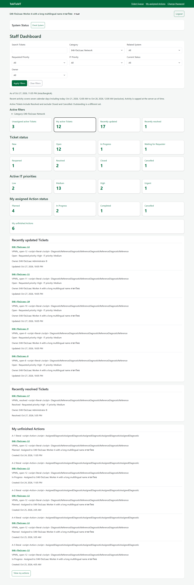
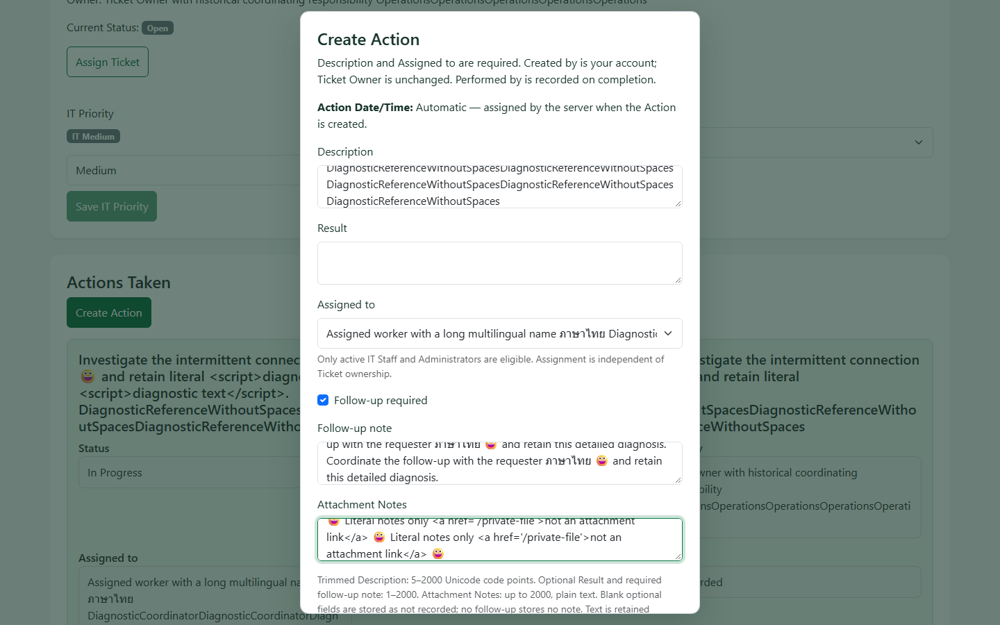
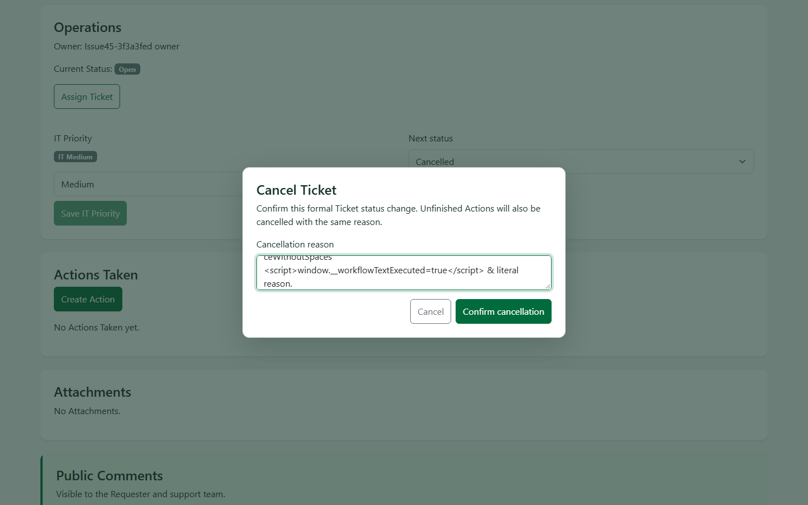
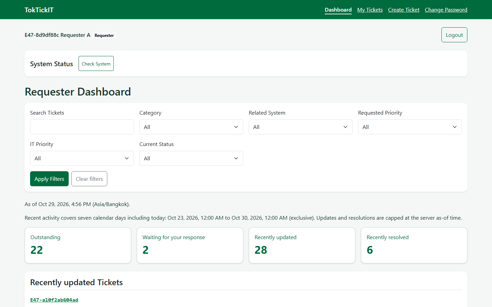
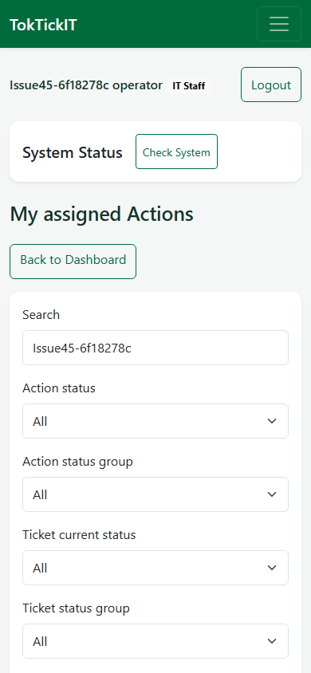

# TokTickIT Lab4 - Parts 1-9 report draft

สิริกร ฝันนิมิตร (ไทเกอร์) · Student ID 67070507215 · GitHub chaproi

**DRAFT - reviewer decision and student reflection pending; not submitted**

Main integration: `040e13b78893ab8155bac89758334adf1a045b01`. Latest comprehensive server: **2,109 passed / 1 failed**, not a complete pass. The standalone PATCH pass is separate evidence.

## Answer Part 1 - Git Use with Engineering Workflow (10)

TokTickIT was developed through feature branches and peer-reviewed PRs into lab 4-staging, followed by reviewed staging-to-main integration. Original requested-changes reviews and later approvals remain separate historical records.

PR 58 was approved by cottonlnwza at 4eecb5f and merged as 7fde762. Release preparation PR 59 then merged into staging. PR 60 received approval at exact staging HEAD a3575a2 on 4 November 2026 at 16:01:10 UTC and merged into main at 16:01:37 UTC as 040e13b78893ab8155bac89758334adf1a045b01. Main and the reviewed staging HEAD have identical tree e26e54a2f9ddf795eeed039ebd12c6485ddd15c0.

Final-main verification exposed failures, so a separate diagnosis branch preserved every attempt. The narrow review branch contains only the legacy test-harness lifecycle correction and report/review documents. Production is unchanged. Main is not edited directly, and no force-push, merge or automatic Issue closure is part of this review.

The new review is limited to the harness diff and an explicit Lab-submission disposition of the remaining PATCH limitation. It does not reopen the accepted Lab 4 implementation, T-37/T-38 observations or limited T-47 decision. Peer decision on this new delta is pending.

Evidence: [Reviewed main integration PR60](https://github.com/chaproi/toktickit/pull/60); [Exact integration approval](https://github.com/chaproi/toktickit/pull/60#pullrequestreview-5771526299); [Accepted hardening PR58](https://github.com/chaproi/toktickit/pull/58#pullrequestreview-5769874363).

## Answer Part 2 - Specification-Driven Development (5)

The six Lab 4 documents separate handout requirements, inherited Labs 1-3 behavior, SDS conflicts and accepted design decisions. The preserved traceability totals are 31 functional requirements, 46 business rules, 45 acceptance criteria, 55 scenario identities and 20 accepted decisions. No identifiers or Product DoD checkbox states are promoted by this report.

Actions retain separate creator, assignee and actual completing actor. Ticket workflow preserves all eight states, inherited guards and legacy nullable owners. Dashboard definitions explicitly distinguish session-owned Requester scope from filtered global Staff scope and actor-specific ownership/assignment.

The accepted D-12/D-13 amendment coordinates participating commands before transaction startup, with ordered resource/User/session/Ticket/Action protection, authoritative revalidation, authorized receipt replay and atomic persistence. Read-only Dashboard/list paths keep one REPEATABLE READ snapshot. Retry remains at most three fresh attempts only for trusted structur ed40001; generic P2034/P2028, deadlock or message matching is not promoted to retryable.

The 55-row map links requirements to specific assertions and recorded revisions. Suite totals alone are not proof that every shared scenario is wholly complete. Historical Planned tables and prior approvals retain their original meaning.

Evidence: [Specification](https://github.com/chaproi/toktickit/blob/040e13b78893ab8155bac89758334adf1a045b01/docs/lab-04/specification.md); [API contract](https://github.com/chaproi/toktickit/blob/040e13b78893ab8155bac89758334adf1a045b01/docs/lab-04/api-spec.md); [UI contract](https://github.com/chaproi/toktickit/blob/040e13b78893ab8155bac89758334adf1a045b01/docs/lab-04/ui-spec.md); [All55 evidence reconciliation](https://github.com/chaproi/toktickit/blob/040e13b78893ab8155bac89758334adf1a045b01/docs/lab-04/hardening-closeout-2026-11-04.md).

## Answer Part 3 - Test-Driven Development and Traceability (10)

Recorded tests-first implementation is distinguished from later verification. For example, Dashboard Navigation RED 09414f9 preceded GREEN f81da7f. Matrix/date/security additions that passed immediately remain verification evidence; they are not rewritten as RED.

The latest harness diagnosis reproduced 3 timed-out cases and 1 pass in the representative legacy file. Its first App import alone took 6396.788 ms inside a 5000 ms case. Timed-out work kept running and queued later cases; the second waited 4851.286 ms. The focused correction loads the real App graph once under the existing default setup hook and injects a fresh guarded real client per case. Migrations, seed, password hashing, real login and business assertions remain per-case. No timeout or expected outcome is relaxed.

The corrected instrumented file passed 4/4, and all 4 passed again in the single full-server diagnostic. The executable temporary observer was then removed; the minimal source was type-checked. These executions used instrumented pending test bytes, not the later publication commit. No exact-publication-HEAD runtime claim is made.

The latest comprehensive server result is 99 files/2110 executed:2109 passed, 1 failed, 0 skipped, exit 1. The failure is the PATCH cohort expecting HTTP 200 and receiving 500. A later standalone PATCH run passed 1/1 with 90 writes and 57 reads, but does not erase that failed comprehensive result. Round-by-round counts and provenance are in the appendix.

Evidence: [Navigation RED](https://github.com/chaproi/toktickit/commit/09414f9ac39bdcfdaf83e10e5e8661a7bb79dc54); [Navigation GREEN](https://github.com/chaproi/toktickit/commit/f81da7fe0c7ee0f6f77485cc52318585eae71fd1); [Harness RED/GREEN and full result](https://github.com/chaproi/toktickit/blob/458ffd72354e878e87d5d4b2498a7c24a17ee154/artifacts/lab-04/release/legacy-timeout-040e13b-2026-11-05/diagnosis.md); [Actual full-run JSON](https://github.com/chaproi/toktickit/blob/458ffd72354e878e87d5d4b2498a7c24a17ee154/artifacts/lab-04/release/legacy-timeout-040e13b-2026-11-05/full-vitest.json).

## Answer Part 4 - AI Use with Reflection (5)

Codex assisted contract analysis, test/implementation drafting, repository inspection, diagnosis, evidence checking and report preparation. The historical record identifies GPT-6 at the family level; an exact served variant, temperature or token total was not independently exposed. AI assistance is not student or peer approval.

Seven actual selected task prompts are recorded in ai-use.md: P-01 contract analysis; P-02 six-document draft; P-03 review corrections; P-04 student decision record; P-06 contract publication; P-07 publication-evidence correction; P-08 completed-review record. The continuation message P-05 is not inflated into an additional substantive prompt.

Human Narrator reports are attributed only to actual student statements. Playwright checks semantics/focus and AI inspects images; neither is described as hearing Narrator. This document does not fabricate personal experience, approval or transcripts.

### Student-authored reflection

**Not written by AI. Student to supply their own words.**

- What did you personally use AI for?

  [Student response]

- What did you independently inspect or correct?

  [Student response]

- What did you learn, and what would you change next time?

  [Student response]

Evidence: [Actual prompts/model/activity record](https://github.com/chaproi/toktickit/blob/040e13b78893ab8155bac89758334adf1a045b01/docs/lab-04/ai-use.md); [Student observation provenance](https://github.com/chaproi/toktickit/blob/040e13b78893ab8155bac89758334adf1a045b01/docs/lab-04/student-requester-observations-2026-11-04.md).

## Answer Part 5 - Working IT Staff Dashboard UI (5)

Staff and Administrators use API-09 and /staff/dashboard with the same global Ticket metric scope under the seven approved base filters. Actor-specific mine and My Actions values are derived from the current session, not client-selected identity. An actor with no assignments can still see nonzero global filtered Ticket data.

Active Ticket ownership/IT-priority metrics include RESOLVED and exclude CLOSED/CANCELLED. Eight Ticket-status bins, four active IT-priority bins, four current-assignee Action bins and unfinished Actions retain zero bins. My Actions means assignee=current actor, not creator, performer or Ticket Owner; unfinished top 5 uses oldest-first creation/id order.

Recent lists are bounded, safely projected and consistently ordered. Dashboard predicates intersect ordinary filters and drill-downs; ordinary Staff Queue mine/unassigned counters preserve inherited owner-replacement semantics. Loading, empty, error/retry and account-switch isolation are covered by recorded API/component/browser checks. The figure below is reused historical evidence, not a new capture.

F1: Historical Staff Dashboard, IT_STAFF, 1440 x 900; Chromium 153.0.8010.12; execution e67436c with pending browser tests and unchanged production, 27 October 2026 Bangkok. Not a final-main capture. [Capture metadata](https://github.com/chaproi/toktickit/blob/040e13b78893ab8155bac89758334adf1a045b01/artifacts/lab-04/screenshots/staff-dashboard/dashboard-1440.json). SHA256 `15772091e1776d5c259b098895e00024aa19df64cdb87da7e85387d2a19b42cd`.

Evidence: [Staff Dashboard tests and provenance](https://github.com/chaproi/toktickit/blob/040e13b78893ab8155bac89758334adf1a045b01/artifacts/lab-04/screenshots/staff-dashboard/evidence.md); [Current Staff dashboard service](https://github.com/chaproi/toktickit/blob/040e13b78893ab8155bac89758334adf1a045b01/server/src/dashboards/staff-dashboard-service.ts).

## Answer Part 6 - Working Actions Taken UI (10)

Staff/Admin create, edit, reassign, start, complete and cancel Actions through real APIs. Active eligible assignee selection is separate from Ticket ownership. Completion records the actual actor and server time, including eligible non-assignee completion. Terminal/frozen-parent, authorization, version and parent-token guards remain authoritative.

Follow-up requirements and valid notes are preserved. Turning follow-up off when a note exists requires the approved explicit clearing confirmation. Attachment Notes are plain text and are separate from binary attachments and private Internal Notes. History renders literal text and immutable before/after attribution; owned Requesters have read-only presentation without mutation controls.

Real-browser evidence covers late initial-read assignee rejection and deliberate eligibility reload/reselection, plus controlled committed-write response loss and identical receipt replay. Injected transport loss is labelled and is not presented as a natural database outage. The inherited receipt and rollback assertions remain; this report adds no new execution.

F2: Historical Create Action dialog, 1440 x 900, 10 October 2026 Bangkok; execution 5e77f1b with pending production corrections later committed unchanged as edb378d. Not a post-commit/final-main capture. [Capture metadata](https://github.com/chaproi/toktickit/blob/040e13b78893ab8155bac89758334adf1a045b01/artifacts/lab-04/screenshots/actions-taken/1440x900-create.json). SHA256 `ebfe3784c36aae56af0a7516ae3c26d94b55dfe6e81f2eefe0db530ec52a0aee`.

Evidence: [Actions workflow/browser evidence](https://github.com/chaproi/toktickit/blob/040e13b78893ab8155bac89758334adf1a045b01/artifacts/lab-04/screenshots/actions-taken/evidence.md); [Browser workflow assertions](https://github.com/chaproi/toktickit/blob/040e13b78893ab8155bac89758334adf1a045b01/e2e/lab-04/actions-taken-flow.spec.ts).

## Answer Part 7 - Working Ticket Workflow (5)

The complete inherited eight-status matrix retains role, owner, confirmation, stale-token, terminal and reopening guards. Requester resolution indication is advisory; it does not perform a formal status transition. Reopening clears both paired indication fields.

Both Resolve and Close reject unfinished PLANNED/IN_PROGRESS Actions inside the transaction. Otherwise-valid zero-Action, all-cancelled and completed-with-follow-up cases are permitted; no positive-completion, followUp=false or workCycle requirement is added.

Ticket cancellation atomically cancels only unfinished Actions, preserving terminal children. Each affected child receives the same validated reason, one version increase, coherent server timestamps and complete ACTION_CANCELLED_BY_TICKET snapshots linked to the actual same-Ticket status event. Controlled late faults prove rollback, separately from genuine coordinated races.

D-20 retains accepted optional non-cancellation reasons, including trimmed empty text, while cancellation retains its mandatory 5-500 rule. The additive compatibility migration preserves historical nullable reasons and does not backfill them. UI blockers, stale recovery and confirmed-save/failed-refresh recovery are recorded with their actual HTTP/database boundaries.

F3: Historical Ticket cancellation dialog, 1440 x 900; execution 430a019, 22 October 2026 UTC/23 October Bangkok; no pending production files. Not a final-main capture. [Capture metadata](https://github.com/chaproi/toktickit/blob/040e13b78893ab8155bac89758334adf1a045b01/artifacts/lab-04/screenshots/ticket-workflow/final/1440x900-cancellation.json). SHA256 `51197f041b781416a0f192ca7de7901b59599c7dababf1b6cc9e7563061a91f0`.

Evidence: [Ticket workflow API suite](https://github.com/chaproi/toktickit/blob/040e13b78893ab8155bac89758334adf1a045b01/server/tests/lab-04/ticket-workflow.api.test.ts); [Workflow browser/layout evidence](https://github.com/chaproi/toktickit/blob/040e13b78893ab8155bac89758334adf1a045b01/artifacts/lab-04/screenshots/ticket-workflow/evidence.md).

## Answer Part 8 - Working Requester Dashboard and Final Regression UI (5)

API-08 scopes every aggregate and bounded list to the session-owned Requester. Outstanding excludes RESOLVED/CLOSED/CANCELLED; attention means WAITING_FOR_REQUESTER and is presented as "Waiting for your response". All-zero widgets do not imply no base-filtered Tickets exist; the UI says "No current or recent Dashboard items match these filters."

Bangkok recent windows cover seven calendar days with canonical UTC half-open bounds, one authoritative asOf and a future cap. Recent resolutions count distinct currently RESOLVED/CLOSED Tickets with actual qualifying resolution history, using the latest qualifying event; no legacy updatedAt fallback. Counts, filters, pagination and descriptors are tested for equivalent intersections within coherent read-only snapshots.

Final-main client tests 352/352 and build, server build, and normal E2E 77/77 passed at 040e13b. The server command did not pass completely: the initial invocation had generated-client setup failure, the next run was incomplete, and the later one full diagnostic reported 2109/2110. Those rounds are kept separate. Earlier Labs 1-3 auth, ownership, comments, private Notes, attachments and administration have recorded regression contributions, not a blanket claim overriding the current PATCH failure.

F4: Historical Requester role Dashboard, 1440 x 900, 29 October 2026 Bangkok; execution f81da7f with pending test/harness/artifact files and no pending production. Not a final-main capture. [Capture metadata](https://github.com/chaproi/toktickit/blob/040e13b78893ab8155bac89758334adf1a045b01/artifacts/lab-04/screenshots/dashboard-navigation/requester-desktop.json). SHA256 `dad6af88430df5a2dc47f39727cd9ac575f2b59921ad2ddaeec4cd476fcb439b`.

Evidence: [Original final-main commands](https://github.com/chaproi/toktickit/blob/458ffd72354e878e87d5d4b2498a7c24a17ee154/artifacts/lab-04/release/final-main-command-records-2026-11-05/commands.json); [Requester evidence](https://github.com/chaproi/toktickit/blob/040e13b78893ab8155bac89758334adf1a045b01/artifacts/lab-04/screenshots/requester-dashboard/evidence.md); [Snapshot tests](https://github.com/chaproi/toktickit/blob/040e13b78893ab8155bac89758334adf1a045b01/server/tests/lab-04/dashboard-snapshot.integration.test.ts).

## Answer Part 9 - Zen Green UI, Responsive, Accessibility and Final Polish (5)

Existing evidence covers 390 x 844, 834 x 1112 and 1440 x 900, plus genuine tab zoom 1.0→2.0→1.0 through chrome.tabs.setZoom/getZoom. Geometry, wrapping, scroll reachability, labels/errors, keyboard focus, dialog containment, inertness, Escape and focus return are distinguished from screenshot inspection and actual student Narrator reporting.

The peer accepted the recorded Lab-level T-37/T-38 evidence and Chrome/Chromium + Microsoft Edge scope in PR 58. Other engine/OS/assistive-technology combinations remain untested; sampled contrast and keyboard checks do not certify WCAG. AI did not hear speech. No new audio session, image capture or browser exercise was run for this report.

T-47 retains all A-B-B-A outcomes: A 1 and B 2 passed every inline assertion; B 3 and A 4 failed. B 2 is one complete B observation with aggregate p 95=401.518 ms and 18/18 operation targets. B 3 CREATE p 95=506.970 ms and A 4 aggregate p 95=963.614 ms remain failed against unchanged p 95<500 ms. The peer accepted that limited Lab disposition, not stable capacity or production readiness.

Other retained limits include failed-start bookkeeping metadata until disconnect without an established memory-growth bound, untriaged dependency-audit findings, and historical unknown causes. The new PATCH comprehensive failure still needs an explicit scoped reviewer disposition. Student reflection, final draft approval/PDF sign-off and actual submission are not completed by this report.

F5: Historical mobile My Actions, 390 x 844, 10 October 2026 Bangkok; execution 5e77f1b plus corrections later edb378d. Normal 100%zoom; this picture is not itself 200%zoom evidence. [Capture metadata](https://github.com/chaproi/toktickit/blob/040e13b78893ab8155bac89758334adf1a045b01/artifacts/lab-04/screenshots/actions-taken/390x844-my-actions.json). SHA256 `377d68493b41aabaabb2dbbc29513baf20aaf2bbbddfd53aefdbe824ed324f1b`.

Evidence: [Accepted observation/performance disposition](https://github.com/chaproi/toktickit/blob/040e13b78893ab8155bac89758334adf1a045b01/docs/lab-04/t37-t38-decision-checklist.md#10-final-peer-disposition-and-staging-integration--2026-11-04); [ABBA evidence](https://github.com/chaproi/toktickit/blob/040e13b78893ab8155bac89758334adf1a045b01/docs/lab-04/closeout-verification-proposal.md); [Current PATCH attribution](https://github.com/chaproi/toktickit/blob/458ffd72354e878e87d5d4b2498a7c24a17ee154/artifacts/lab-04/release/patch-holder-2026-11-05/diagnosis.md).

## Appendix A - Round-by-round execution, not cumulative passing totals

| Round | Actual source state | Result | Qualification |
| --- | --- | --- | --- |
| Historical correctness | 8e80cd4 +pending production later 0abd40d | Server 99 files; 2110/2110 pass; build passed | Historical, not final-main execution |
| Final-main client | 040e13b clean source | 24 files; 352 pass; 0 fail/skip; exit 0; 111.389 s | Build exit 0; 41.461 s |
| Final-main server setup | 040e13b | 0 collected/executed; setup error; exit 1; 16.650 s | Generated Prisma placeholder; explicit generation succeeded |
| Post-generation server | 040e13b | Incomplete:33 file summaries; 1580 pass/11 fail/96 skip | Final exit/duration unknown; 1420.654 s is log window only |
| Final-main server build | 040e13b | exit 0; 50.372 s | No test-case count |
| Final-main normal E2E | 040e13b | 16 files; 77/77 pass; exit 0; 809.244 s | 1 worker; 0 retries; normal setup/teardown |
| First bounded diagnosis | 040e13b | PATCH 1/1 pass 40.076 s; admission 14/14 pass 15.057 s | Does not replace original failure |
| Legacy phase RED | 040e13b +test instrumentation | 4 executed; 1 pass/3 fail; exit 1; 45.040 s | First App import 6396.788 ms; unchanged 5000 ms case |
| Legacy harness GREEN | Same production +specific harness change | 4/4 pass; exit 0; 15.014 s | Instrumentation enabled; later stripped without new runtime claim |
| Latest full diagnostic | 040e13b production +instrumented harness | 99 files; 2110 executed; 2109 pass/1 fail; exit 1; 1211.236 s | Only T-47 excluded; PATCH expected 200/actual 500 |
| Latest standalone PATCH | 73872c1 +temporary observer | 1/1 pass; 147 HTTP 200; exit 0; 45.094 s | 81 live samples; historical holder still unknown |

Windows 11 HomeSingleLanguage 10.0.26200; Node 24.14.0; npm 11.9.0; Prisma/client/adapter/generated 6.19.3; PostgreSQL 18.6; Vitest 2.1.9; Playwright 1.63.0; Chromium 153.0.8010.12; Edge 156.0.4314.58. Dedicated guarded PostgreSQL; no operational reset.

Client React act/Router/jsdom warnings retained; pg concurrent-query deprecation retained. Client npm ci audit 9 findings(5 moderate, 2 high, 2 critical); server 15(5 moderate, 7 high, 3 critical), untriaged. No dependency fix or new application run in this publication.

All command records and cleanup retain their original provenance. No test, build, E2E or benchmark ran during this report/PR preparation.

## Appendix B - Release fields still awaiting completion

- New narrow harness/limitation review: Pending actual reviewer decision.
- Student reflection: student-authored text not yet supplied.
- Final report approval: pending; this PDF is a draft.
- Actual submission: not performed.
- No Product DoD/scenario checkbox states changed.

[PDF draft](../../output/pdf/toktickit-lab4-parts-1-9-draft.pdf). [Scoped review decision](final-main-review-2026-11-05.md).
